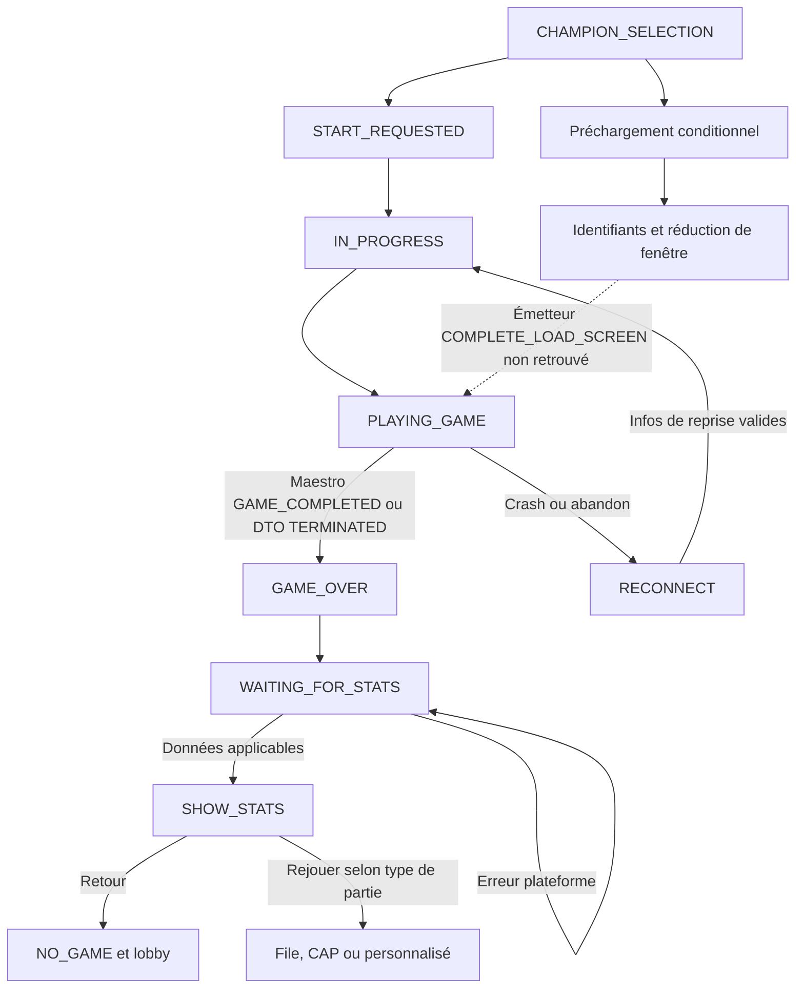
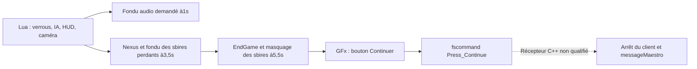
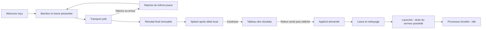

# SYS-01.1-06 — Chargement, fin de partie et retour

Référence : **PUBLIC4.20.0.315, Releases/4.20, EUW/en_GB**, build littéral2014-11-17/17:46:45, fuseau et déploiement non établis ; catalogue4.20.1. AIR **4.20.14_11_18_18_52**, releaseRADS0.0.1.119. Relevé du20octobre2026.

Le résultat est un **recensement de sources et de consommateurs**, intégré à la tâche du plan. Les étiquettes de repères historiques, les constantes AIR, les prédicats de préchargement et les politiques Rust ont des espaces de noms distincts. Un état `PLAYING_GAME`, `GameStarted` ou `playing` n’atteste pas à lui seul que tous les joueurs ont chargé la carte. Aucune reconstruction de gameplay, nouvelle qualification graphique/audio ou exécution du jeu historique n’est livrée.

Le [contrat structuré](reference_loading_return_4_20.json) contient les états, les parcours conditionnels, les gardes et les ancres avec SHA-256. Le [reçu de vérification](reference_loading_return_4_20_verification.json) conserve les commandes, résultats et contrôles du consommateur. Les snapshots sont dans `reference_loading_return_sources/`. Les originaux AIR restent liés à la release exacte via le référentiel SYS05 et ses bibliothèques originales ; ils ne sont pas présentés comme du code source fourni par Riot.

## Contrat et entrées

La tâche, la ficheD01-SYS-01-1 et la phaseD01 n’ont aucune dépendance déclarée. Les entrées nécessaires sont présentes : référence du client, référentiel AIR complet (9139 exports), bibliothèques d’origine et manifeste119, Lua/GFx natifs et code Rust actuel. Les cinq sources de la référence native sont relues par le vérificateur. Le client4.20 n’est pas lancé. La version des deux builds demeure celle de SYS02 ; son récent complément est conservé.

Le consommateur documentaire est `tools/project-plan/instructions.py:make_instruction`, puis le catalogueSQLite utilisé par le site local et l’applicationTauri installée. Le registre ne change que pour SYS-01.1-06. Les noms des états sont des faits recensés, pas une acceptation utilisateur. La graine de première installationTauri reste inchangée ; l’application existante lit sa base liée.

## Parcours principal AIR



Les arêtes résument des parcours qui peuvent traverser plusieurs callbacks. Le tableau exhaustif ci-dessous précise les conditions ; il ne définit pas un nouvel automate unique. PRE/CHAMP/POST_CHAMP_SELECT se regroupent dans la vueCHAMPION_SELECTION. Les DTOFAILED_TO_START etTERMINATED_IN_ERROR entraînent erreur/nettoyage, sans fabrication d’une victoire. La présence XMPP et l’activation des vues viennent du setter `MasterGameController.currentState` ; elles ne remplacent pas le protocole du jeu.

Le préchargement est désactivé par défaut dansClientConfig. Il exige `_shouldPreload`, un fournisseurMaestro et son démarrage. Le contrôleur gère les deux ordres « prêt puis réduction » et « réduction puis prêt », les credentials, le crash et l’interruption. Le messageMaestro30 n’exécute aucune action dans le dispatch original ;33 émet le signalGameLoadingComplete. Le récepteurGameEvent.COMPLETE_LOAD_SCREEN existe, mais son émetteur et son lien avec33 ne sont pas établis dans les9139 exports. La branche normale sans préchargement reste recensée séparément.

Au retour, le cache des résultats n’est utilisé que pour la même partie. Sinon AIR attend les statistiques et vérifie la connexion ; une alerte serveur ne prouve pas leur réception. Tutoriel basique, avancé, spectateur, replay, dons de fin de partie et Rejouer ont leurs gardes. Les fixturesHardcodedEndOfGameStats etmockEoGStats ne prouvent jamais les résultats d’une partie réelle.

## Client natif : chronologie et frontière Continuer



Les délais sont ceux du profil par défaut : pan3s, changement de skin3,5s, délai de scoreboard2s, avec les valeurs de getters issues d’une preuve native antérieure conservée. Les16 scénarios Lua5.1 de cette tâche ont exécuté les instructions originales après adaptation de la largeur32→64bits des seules longueurs de chaînes. Ils couvrent les deux vainqueurs,0/1/6/12 champions adaptés et la branche d’animation de mort vraie/fausse. API moteur, champions et minuteries sont **des adaptateurs** ; le planificateur natif, le rendu, les interpolations et le mixage ne sont pas exécutés. `SetMinionsNoRender(loser,true)` ne vise que les sbires perdants. TestReviveNexus et les cheats ne deviennent pas des états normaux.

Le GFx original est exporté par FFDec26.4.0 :31 scriptsAS2. Press_Continue est soumis au curseur actif, à la présence du parent, à la communication activée et à l’absence de drag. `fscommand` est remplacé par un observateur dans les tests. Aucun récepteurC++ ni lien automatique avec STOPPED1 n’est inventé. Le p-code AVM2 original confirme aussi que `InGameController.deactivate` compare `currentState==connected` puis jette le résultat : il ne réaffecte pas cet état.

## Moteur et launcher Rust actuels



Ces parcours sont des politiques locales distinctes du protocole4.20. `session_client`, `session_connection` et `session_transport` distinguent contexte, nonce/epoch, Welcome, barrière, trame livrée/présentée, reprise et révocation. La disponibilitéBusy attend ; Detached prépareResume ; Retired/Closing refuse. Le silenceUDP5s déclenche la récupération du même joueur, pas une victoire ou un nouveauJoin. Les délais et règles privés ne prouvent pas une compatibilité du client natif.

Le résultat est figé côtécore ; le délai de5,5s du profil local part de sa **première réception**, pas de la minuterie native historique. Continuer masque seulement le splash ; Retour requiert résultat/session/joueur courants et appui/relâchement armés. Leave est idempotent ; l’échec du départ sécurisé conserve la réservation. Le nettoyage propriétaire distingueService, Runtime etApplication et conserve les erreurs. Le serveur possédé s’arrête seulement en drain, sans participants, et avec résultat sauvegardé s’il existe. Le client rejoint ne possède aucun serveur.

Le superviseur annonce `playing` à partir du processus. Ce libellé n’est pas un indicateur de chargement complet. Les erreurs sont prioritaires à `reconnecting`, même si `can_resume` est vrai ; les boutons utilisent aussi ces gardes. Les erreurs d’observation ne déclarent jamais un processus fini. Ces règles ont été inspectées dans leur consommateur réel ; aucun test du moteur, compilation ou session graphiqueRust n’a été rejoué pour ce recensement.

## Périmètre du relevé

| Espace de noms | États/repères |
|---|---:|
| air_view | 15 |
| air_server_dto | 11 |
| air_reconnect | 4 |
| air_results | 3 |
| air_application | 3 |
| air_preload | 7 |
| native_log | 15 |
| native_endgame | 7 |
| openleague_process | 8 |
| openleague_transport | 8 |
| openleague_results | 5 |

Total : **86 états/repères, 57 parcours, 22 gardes, 149 ancres uniques, 104 sources hachées.**

## Tous les états et repères recensés

| Identifiant | Valeur/libellé | Nature | Sources |
|---|---|---|---|
| view.TUTORIAL_GAME | TUTORIAL_GAME | original_constant | [A001](reference_loading_return_sources/air/GameViewState.as#L6), [A002](reference_loading_return_sources/air/MasterGameController.as#L974) |
| view.JOIN_GAME | JOIN_GAME | original_constant | [A003](reference_loading_return_sources/air/GameViewState.as#L8), [A002](reference_loading_return_sources/air/MasterGameController.as#L974) |
| view.CAP_STATE | CAP_STATE | original_constant | [A004](reference_loading_return_sources/air/GameViewState.as#L10), [A002](reference_loading_return_sources/air/MasterGameController.as#L974) |
| view.TEAM_SELECTION | TEAM_SELECT | original_constant | [A005](reference_loading_return_sources/air/GameViewState.as#L12), [A002](reference_loading_return_sources/air/MasterGameController.as#L974) |
| view.CHAMPION_SELECTION | CHAMP_SELECT | original_constant | [A006](reference_loading_return_sources/air/GameViewState.as#L14), [A002](reference_loading_return_sources/air/MasterGameController.as#L974) |
| view.START_REQUESTED | START_REQUESTED | original_constant | [A007](reference_loading_return_sources/air/GameViewState.as#L16), [A002](reference_loading_return_sources/air/MasterGameController.as#L974) |
| view.CREATE_GAME | CREATE_GAME | original_constant | [A008](reference_loading_return_sources/air/GameViewState.as#L18), [A002](reference_loading_return_sources/air/MasterGameController.as#L974) |
| view.IN_PROGRESS | IN_PROGRESS | original_constant | [A009](reference_loading_return_sources/air/GameViewState.as#L20), [A002](reference_loading_return_sources/air/MasterGameController.as#L974) |
| view.PLAYING_GAME | PLAYING_GAME | original_constant | [A010](reference_loading_return_sources/air/GameViewState.as#L22), [A002](reference_loading_return_sources/air/MasterGameController.as#L974) |
| view.GAME_OVER | GAME_OVER | original_constant | [A011](reference_loading_return_sources/air/GameViewState.as#L24), [A002](reference_loading_return_sources/air/MasterGameController.as#L974) |
| view.NO_GAME | (NO_GAME) | original_constant | [A012](reference_loading_return_sources/air/GameViewState.as#L26), [A002](reference_loading_return_sources/air/MasterGameController.as#L974) |
| view.JOIN_QUEUE | NORMAL_JOIN_QUEUE | original_constant | [A013](reference_loading_return_sources/air/GameViewState.as#L28), [A002](reference_loading_return_sources/air/MasterGameController.as#L974) |
| view.WAIT_FOR_GAME | NORMAL_WAIT_FOR_GAME | original_constant | [A014](reference_loading_return_sources/air/GameViewState.as#L30), [A002](reference_loading_return_sources/air/MasterGameController.as#L974) |
| view.WAIT_FOR_GAME_AFTER_MATCH | NORMAL_WAIT_FOR_GAME_AFTER_MATCH | original_constant | [A015](reference_loading_return_sources/air/GameViewState.as#L32), [A002](reference_loading_return_sources/air/MasterGameController.as#L974) |
| view.WAIT_FOR_JOINING_GAME | WAIT_FOR_JOINING_GAME | original_constant | [A016](reference_loading_return_sources/air/GameViewState.as#L34), [A002](reference_loading_return_sources/air/MasterGameController.as#L974) |
| dto.TEAM_SELECTION | TEAM_SELECT | original_constant | [A017](reference_loading_return_sources/air/GameState.as#L6) |
| dto.PRE_CHAMPION_SELECTION | PRE_CHAMP_SELECT | original_constant | [A018](reference_loading_return_sources/air/GameState.as#L8) |
| dto.CHAMPION_SELECTION | CHAMP_SELECT | original_constant | [A019](reference_loading_return_sources/air/GameState.as#L10) |
| dto.POST_CHAMPION_SELECTION | POST_CHAMP_SELECT | original_constant | [A020](reference_loading_return_sources/air/GameState.as#L12) |
| dto.START_REQUESTED | START_REQUESTED | original_constant | [A021](reference_loading_return_sources/air/GameState.as#L14) |
| dto.IN_PROGRESS | IN_PROGRESS | original_constant | [A022](reference_loading_return_sources/air/GameState.as#L16) |
| dto.TERMINATED | TERMINATED | original_constant | [A023](reference_loading_return_sources/air/GameState.as#L18) |
| dto.TERMINATED_IN_ERROR | TERMINATED_IN_ERROR | original_constant | [A024](reference_loading_return_sources/air/GameState.as#L20) |
| dto.FAILED_TO_START | FAILED_TO_START | original_constant | [A025](reference_loading_return_sources/air/GameState.as#L22) |
| dto.JOINING_CHAMP_SELECT | JOINING_CHAMP_SELECT | original_constant | [A026](reference_loading_return_sources/air/GameState.as#L24) |
| dto.CHAMP_SELECT_AFK_CLEANUP | CHAMP_SELECT_AFK_CLEANUP | original_constant | [A027](reference_loading_return_sources/air/GameState.as#L26) |
| ingame.PLAYING_CONNECTED | connected | original_constant | [A028](reference_loading_return_sources/air/InGameController.as#L31) |
| ingame.PLAYING_DISCONNECTED | disconnected | original_constant | [A029](reference_loading_return_sources/air/InGameController.as#L33) |
| ingame.PLAYING_CRASHED | crash | original_constant | [A030](reference_loading_return_sources/air/InGameController.as#L35) |
| ingame.PLAYING_SPECTATOR_DISCONNECT | spectatorDisconnected | original_constant | [A031](reference_loading_return_sources/air/InGameController.as#L37) |
| result.WAITING_FOR_STATS | waitingForStats | original_constant | [A032](reference_loading_return_sources/air/EndOfGameStatsController.as#L101) |
| result.SHOW_STATS | showStats | original_constant | [A033](reference_loading_return_sources/air/EndOfGameStatsController.as#L103) |
| result.TUTORIAL_GAME_WRAPUP | showTutorialGame | original_constant | [A034](reference_loading_return_sources/air/EndOfGameStatsController.as#L105) |
| app.LOGIN | login | original_constant | [A035](reference_loading_return_sources/air/IAppControllerConstants.as#L6) |
| app.LOBBY | lobby | original_constant | [A036](reference_loading_return_sources/air/IAppControllerConstants.as#L8) |
| app.RECONNECT | reconnect | original_constant | [A037](reference_loading_return_sources/air/IAppControllerConstants.as#L20) |
| preload.disabled | Préchargement désactivé ou Maestro absent | local_predicate_label | [A038](reference_loading_return_sources/air/LolGamePreloadController.as#L158) |
| preload.requested | Demande de préchargement envoyée | local_predicate_label | [A039](reference_loading_return_sources/air/LolGamePreloadController.as#L72) |
| preload.credentials | Identifiants transmis au client préchargé | local_predicate_label | [A040](reference_loading_return_sources/air/LolGamePreloadController.as#L82) |
| preload.wait_minimize | Prêt à jouer, attente de réduction de fenêtre | local_predicate_label | [A041](reference_loading_return_sources/air/LolGamePreloadController.as#L94) |
| preload.play_requested | Commande de lecture du client préchargé | local_predicate_label | [A042](reference_loading_return_sources/air/LolGamePreloadController.as#L142) |
| preload.crashed | Préchargement abandonné/crash : désactivation | local_predicate_label | [A043](reference_loading_return_sources/air/LolGamePreloadController.as#L126) |
| preload.halted | Interruption demandée du préchargement actif | local_predicate_label | [A044](reference_loading_return_sources/air/LolGamePreloadController.as#L133) |
| log.disconnected | disconnected | historical_logged_milestone | [A045](reference_loading_return_sources/probes/filtered-log-events.json#L156) |
| log.game_exit | game_exit | historical_logged_milestone | [A046](reference_loading_return_sources/probes/filtered-log-events.json#L66) |
| log.game_shutdown | game_shutdown | historical_logged_milestone | [A047](reference_loading_return_sources/probes/filtered-log-events.json#L73) |
| log.hard_connect | hard_connect | historical_logged_milestone | [A048](reference_loading_return_sources/probes/filtered-log-events.json#L36) |
| log.maestro_initialized | maestro_initialized | historical_logged_milestone | [A049](reference_loading_return_sources/probes/filtered-log-events.json#L18) |
| log.maestro_initializing | maestro_initializing | historical_logged_milestone | [A050](reference_loading_return_sources/probes/filtered-log-events.json#L12) |
| log.playgame_startup | playgame_startup | historical_logged_milestone | [A051](reference_loading_return_sources/probes/filtered-log-events.json#L48) |
| log.preload_effects | preload_effects | historical_logged_milestone | [A052](reference_loading_return_sources/probes/filtered-log-events.json#L54) |
| log.preload_effects_finished | preload_effects_finished | historical_logged_milestone | [A053](reference_loading_return_sources/probes/filtered-log-events.json#L60) |
| log.reconnect_popup | reconnect_popup | historical_logged_milestone | [A054](reference_loading_return_sources/probes/filtered-log-events.json#L150) |
| log.soft_reconnect | soft_reconnect | historical_logged_milestone | [A055](reference_loading_return_sources/probes/filtered-log-events.json#L282) |
| log.waiting_client_id | waiting_client_id | historical_logged_milestone | [A056](reference_loading_return_sources/probes/filtered-log-events.json#L30) |
| log.waiting_connection | waiting_connection | historical_logged_milestone | [A057](reference_loading_return_sources/probes/filtered-log-events.json#L24) |
| log.waiting_server | waiting_server | historical_logged_milestone | [A058](reference_loading_return_sources/probes/filtered-log-events.json#L42) |
| log.winmain_exit | winmain_exit | historical_logged_milestone | [A059](reference_loading_return_sources/probes/filtered-log-events.json#L79) |
| native.ceremony | Cérémonie : verrous, HUD et IA | original_script_phase | [A060](reference_loading_return_sources/evidence/endgame_lua_source_audit.json#L10) |
| native.camera | Caméra vers le Nexus perdant | original_script_phase | [A060](reference_loading_return_sources/evidence/endgame_lua_source_audit.json#L10) |
| native.sound | Phase de fondu audio principal | original_script_phase | [A061](reference_loading_return_sources/evidence/endgame_lua_source_audit.json#L22) |
| native.destroy | Phase de destruction du Nexus | original_script_phase | [A062](reference_loading_return_sources/evidence/endgame_lua_source_audit.json#L28) |
| native.minions | Fin du rendu des sbires perdants | original_script_phase | [A063](reference_loading_return_sources/evidence/endgame_lua_source_audit.json#L34) |
| native.scoreboard | EndGame et demande de tableau de résultats | original_script_phase | [A064](reference_loading_return_sources/evidence/endgame_lua_source_audit.json#L40) |
| native.continue | Commande GFx Press_Continue | original_script_phase | [A065](reference_loading_return_sources/gfx-review/__Packages/DDW/Components/DefaultButton.as#L288), [A066](reference_loading_return_sources/gfx-review/__Packages/DDW/Communication/Comm.as#L6) |
| process.owned.idle | idle | explicit_local_policy | [A067](reference_loading_return_sources/current/launcher/src-tauri/src/sessions.rs#L182) |
| process.owned.playing | playing | explicit_local_policy | [A067](reference_loading_return_sources/current/launcher/src-tauri/src/sessions.rs#L182) |
| process.owned.draining | draining | explicit_local_policy | [A067](reference_loading_return_sources/current/launcher/src-tauri/src/sessions.rs#L182) |
| process.owned.reconnecting | reconnecting | explicit_local_policy | [A067](reference_loading_return_sources/current/launcher/src-tauri/src/sessions.rs#L182) |
| process.owned.error | error | explicit_local_policy | [A067](reference_loading_return_sources/current/launcher/src-tauri/src/sessions.rs#L182) |
| process.joined.idle | idle | explicit_local_policy | [A068](reference_loading_return_sources/current/launcher/src-tauri/src/sessions_joined.rs#L82) |
| process.joined.playing | playing | explicit_local_policy | [A068](reference_loading_return_sources/current/launcher/src-tauri/src/sessions_joined.rs#L82) |
| process.joined.error | error | explicit_local_policy | [A068](reference_loading_return_sources/current/launcher/src-tauri/src/sessions_joined.rs#L82) |
| transport.context_waiting | Waiting | explicit_local_policy | [A069](reference_loading_return_sources/current/crates/client/src/session_client.rs#L5) |
| transport.resume_prepared | ResumePrepared | explicit_local_policy | [A069](reference_loading_return_sources/current/crates/client/src/session_client.rs#L5) |
| transport.retired | Retired | explicit_local_policy | [A069](reference_loading_return_sources/current/crates/client/src/session_client.rs#L5) |
| transport.welcome | Welcome validé | explicit_local_policy | [A070](reference_loading_return_sources/current/crates/client/src/session_client.rs#L95) |
| transport.barrier | Barrière du bootstrap attendue | explicit_local_policy | [A071](reference_loading_return_sources/current/crates/client/src/session_client.rs#L16) |
| transport.ready | Trame présentée et barrière prête | explicit_local_policy | [A072](reference_loading_return_sources/current/crates/client/src/session_client.rs#L50) |
| transport.recovering | Même joueur : transport en récupération | explicit_local_policy | [A073](reference_loading_return_sources/current/crates/client/src/session_connection.rs#L5) |
| transport.closed | Leave / départ explicite | explicit_local_policy | [A074](reference_loading_return_sources/current/crates/client/src/session_connection.rs#L280) |
| localresult.frozen | Résultat autoritaire immuable | explicit_local_policy | [A075](reference_loading_return_sources/current/crates/core/src/match_results.rs#L12) |
| localresult.splash | Splash natif adapté, délai local | explicit_local_policy | [A076](reference_loading_return_sources/current/crates/client/src/native_endgame_ui.rs#L13) |
| localresult.results | Résultats locaux visibles après Continuer | explicit_local_policy | [A077](reference_loading_return_sources/current/crates/client/src/match_results_ui.rs#L33) |
| localresult.return | Retour au launcher, AppExit::Success | explicit_local_policy | [A078](reference_loading_return_sources/current/crates/client/src/session_departure.rs#L7) |
| localresult.cleanup | Nettoyage propriétaire et code de sortie | explicit_local_policy | [A079](reference_loading_return_sources/current/crates/client/src/native_runtime_shutdown.rs#L69) |

## Tous les parcours conditionnels

| ID | Départ → arrivée | Déclencheur et garde | Effet / limite | Sources |
|---|---|---|---|---|
| T01 | view.CHAMPION_SELECTION → view.START_REQUESTED | DTO START_REQUESTED ; État serveur et partie courante cohérents ; DTO POST_CHAMP_SELECT reste dans CHAMPION_SELECTION | Préparation du démarrage et fin de sélection. | [A080](reference_loading_return_sources/air/GameState.as#L34), [A081](reference_loading_return_sources/air/MasterGameController.as#L406) |
| T02 | view.START_REQUESTED → view.IN_PROGRESS | Réception des identifiants de partie ; gameId identique à currentGame.id ; observateur refusé dans launchGame | Préparation déléguée éventuelle puis launchGame. | [A082](reference_loading_return_sources/air/MasterGameController.as#L1978), [A083](reference_loading_return_sources/air/MasterGameController.as#L2008) |
| T03 | view.IN_PROGRESS → view.PLAYING_GAME | Lancement normal ou reconnexion ; Préchargement désactivé/indisponible, ou reconnexion | Maestro createGame si activé ; état AIR PLAYING_GAME. | [A083](reference_loading_return_sources/air/MasterGameController.as#L2008) |
| T04 | view.CHAMPION_SELECTION → preload.requested | Préchargement de la carte ; shouldPreload && maestro présent && maestroStarted | createClientAndPreload ; écoute crash. | [A039](reference_loading_return_sources/air/LolGamePreloadController.as#L72), [A038](reference_loading_return_sources/air/LolGamePreloadController.as#L158) |
| T05 | preload.requested → preload.credentials | Identifiants arrivés ; Préchargement prêt | Mise à jour du client préchargé. | [A040](reference_loading_return_sources/air/LolGamePreloadController.as#L82) |
| T06 | preload.credentials → preload.wait_minimize | completePreload ; Événement minimize pas encore reçu | _readyToPlay=true. | [A041](reference_loading_return_sources/air/LolGamePreloadController.as#L94) |
| T07 | preload.wait_minimize → preload.play_requested | Réduction / demande de réduction ; readyToPlay && preload prêt | playPreloadedGame ; champs prêts/preloading remis à false. | [A084](reference_loading_return_sources/air/LolGamePreloadController.as#L117), [A085](reference_loading_return_sources/air/LolGamePreloadController.as#L106), [A042](reference_loading_return_sources/air/LolGamePreloadController.as#L142) |
| T08 | preload.requested → preload.crashed | Crash ou abandon du client préchargé ; Écouteur enregistré | Désactive la préparation et retire les écouteurs. | [A043](reference_loading_return_sources/air/LolGamePreloadController.as#L126) |
| T09 | preload.requested → preload.halted | haltPreload ; Préchargement prêt et actif | Demande kill via Maestro ; jamais exécutée dans les essais de cette tâche. | [A044](reference_loading_return_sources/air/LolGamePreloadController.as#L133) |
| T10 | preload.play_requested → view.PLAYING_GAME | GameEvent.COMPLETE_LOAD_SCREEN ; Récepteur présent ; émetteur non retrouvé dans les9139 exports | Le récepteur appelle completePreload et termine la sélection ; lien avec IPC33 non prouvé. **Frontière non qualifiée.** | [A086](reference_loading_return_sources/air/MasterGameController.as#L1507), [A087](reference_loading_return_sources/air/MasterGameController.as#L278), [A088](reference_loading_return_sources/air/MaestroController.as#L525) |
| T11 | view.PLAYING_GAME → view.GAME_OVER | Maestro GAME_COMPLETED ; État PLAYING_GAME ou IN_PROGRESS ; mode replay exclu | Restaure AIR ; active le contrôleur de résultats. | [A089](reference_loading_return_sources/air/ApplicationController.as#L552), [A090](reference_loading_return_sources/air/MasterGameController.as#L1825) |
| T12 | view.GAME_OVER → result.WAITING_FOR_STATS | Activation du contrôleur de résultats ; Aucun résultat en cache de la même partie | Attente ; validation du lien plateforme. | [A091](reference_loading_return_sources/air/EndOfGameStatsController.as#L612) |
| T13 | result.WAITING_FOR_STATS → result.SHOW_STATS | Données reçues et présentation applicable ; Partie normale ou tutoriel avancé non basique | Calcul/préparation des vues ; notification de changement. | [A092](reference_loading_return_sources/air/EndOfGameStatsController.as#L373), [A093](reference_loading_return_sources/air/EndOfGameStatsController.as#L646) |
| T14 | result.WAITING_FOR_STATS → result.TUTORIAL_GAME_WRAPUP | Fin du tutoriel basique ; advancedTutorialEnabled | Présente la conclusion du tutoriel. | [A093](reference_loading_return_sources/air/EndOfGameStatsController.as#L646) |
| T15 | result.SHOW_STATS → view.NO_GAME | Retour au lobby / gameFlowComplete ; Variante tutoriel traitée séparément | Nettoyage de partie puis présence hors partie et accueil. | [A094](reference_loading_return_sources/air/EndOfGameStatsController.as#L851), [A095](reference_loading_return_sources/air/MasterGameController.as#L1623), [A096](reference_loading_return_sources/air/MasterGameController.as#L1793) |
| T16 | result.SHOW_STATS → view.JOIN_QUEUE | Rejouer en groupe ; Type normal, classé ou coop en équipe ; allowedtoPlayAgain pour matchmaking ; CAP/custom/solo ont leurs branches | Sauve le modèle, nettoie la partie, recrée la préparation adaptée. | [A097](reference_loading_return_sources/air/EndOfGameStatsController.as#L842), [A098](reference_loading_return_sources/air/MasterGameController.as#L2433), [A099](reference_loading_return_sources/air/MasterGameController.as#L2468), [A100](reference_loading_return_sources/air/MasterGameController.as#L2498) |
| T17 | view.PLAYING_GAME → app.RECONNECT | Crash ou abandon ; Partie ni NO_GAME ni GAME_OVER ; replay exclu | Restaure AIR et affiche la reconnexion. | [A101](reference_loading_return_sources/air/ApplicationController.as#L937) |
| T18 | view.GAME_OVER → app.LOBBY | Crash/abandon après fin déjà connue ; NO_GAME ou GAME_OVER | Retour au lobby ; pas de résultat de victoire fabriqué. | [A101](reference_loading_return_sources/air/ApplicationController.as#L937) |
| T19-crash | ingame.PLAYING_CONNECTED → ingame.PLAYING_CRASHED | Arrêt prématuré ; événement crash, hors tutoriel/spectateur | État distinct, informations de reconnexion conservées selon le contrôleur. | [A102](reference_loading_return_sources/air/InGameController.as#L246), [A103](reference_loading_return_sources/air/InGameController.as#L112) |
| T19-disconnect | ingame.PLAYING_CONNECTED → ingame.PLAYING_DISCONNECTED | Arrêt prématuré ; abandon ou déconnexion normale | État distinct, informations de reconnexion conservées selon le contrôleur. | [A102](reference_loading_return_sources/air/InGameController.as#L246), [A103](reference_loading_return_sources/air/InGameController.as#L112) |
| T19-spectator | ingame.PLAYING_CONNECTED → ingame.PLAYING_SPECTATOR_DISCONNECT | Arrêt prématuré ; spectateur | État distinct, informations de reconnexion conservées selon le contrôleur. | [A102](reference_loading_return_sources/air/InGameController.as#L246), [A103](reference_loading_return_sources/air/InGameController.as#L112) |
| T20 | app.RECONNECT → view.IN_PROGRESS | Reconnexion demandée ; Infos de reconnexion valides ; ID/session de la partie | Lancement joueur ou variante spectateur. | [A104](reference_loading_return_sources/air/InGameController.as#L117), [A105](reference_loading_return_sources/air/InGameController.as#L152), [A106](reference_loading_return_sources/air/MasterGameController.as#L1843) |
| T21 | ingame.PLAYING_DISCONNECTED → ingame.PLAYING_CONNECTED | Maestro GameStarted ; Nouveau démarrage annoncé | Réinitialise reconnectInfo et marque connecté. | [A107](reference_loading_return_sources/air/InGameController.as#L185) |
| T22 | native.ceremony → native.sound | Minuterie Lua ; Délai initial1s, fondu2s dans la configuration par défaut | FadeOutMainSFX ; API et minuteur adaptés dans la VM Lua. | [A061](reference_loading_return_sources/evidence/endgame_lua_source_audit.json#L22) |
| T23 | native.ceremony → native.destroy | Minuterie de destruction ; Valeur par défaut du getter3.5s ; branche animation de mort distincte | Skin du Nexus si approprié, fondu des sbires perdants. | [A062](reference_loading_return_sources/evidence/endgame_lua_source_audit.json#L28) |
| T24 | native.destroy → native.scoreboard | Minuterie Lua après2s ; Configuration par défaut ; branche vraie exécutée séparément | EndGame(winner) à5.5s et arrêt de rendu des sbires perdants. | [A064](reference_loading_return_sources/evidence/endgame_lua_source_audit.json#L40) |
| T25 | native.scoreboard → native.continue | Relâchement du bouton GFx ; Curseur actif, parent présent, communication activée, pas de drag | fscommand Press_Continue. | [A108](reference_loading_return_sources/gfx-review/__Packages/DDW/Components/DefaultButton.as#L272), [A065](reference_loading_return_sources/gfx-review/__Packages/DDW/Components/DefaultButton.as#L288), [A066](reference_loading_return_sources/gfx-review/__Packages/DDW/Communication/Comm.as#L6) |
| T26 | native.continue → view.GAME_OVER | Récepteur moteur/arrêt du processus puis IPC Maestro ; Le récepteur C++ de Press_Continue n’est pas qualifié ici | Ne pas déduire du seul bouton l’émission de STOPPED1 ni la réception des statistiques. **Frontière non qualifiée.** | [A066](reference_loading_return_sources/gfx-review/__Packages/DDW/Communication/Comm.as#L6), [A109](reference_loading_return_sources/air/MaestroController.as#L144) |
| T27 | transport.welcome → transport.ready | Trame livrée et présentée, barrière appliquée ; Aucun échec/pending, presented non nul et identique à delivered | Entrées autorisées selon la politique privée locale. | [A121](reference_loading_return_sources/current/crates/client/src/session_client.rs#L49), [A122](reference_loading_return_sources/current/crates/core/src/session_transport.rs#L202) |
| T28 | transport.ready → transport.recovering | Silence UDP5s ou erreur socket ; Transport privé ; garder même joueur/session | Requête de contexte et reprise, sans Join de remplacement. | [A123](reference_loading_return_sources/current/crates/client/src/session_connection.rs#L4) |
| T29 | transport.recovering → transport.resume_prepared | Réponse Detached ; Contexte/nonce/epoch valides | Prépare Resume puis attend Welcome/barrière. | [A124](reference_loading_return_sources/current/crates/client/src/session_client.rs#L70) |
| T30 | transport.resume_prepared → transport.ready | Nouveau bootstrap et trame présentée ; Barrière et identité courantes validées | Reprise locale après présentation cohérente. | [A121](reference_loading_return_sources/current/crates/client/src/session_client.rs#L49) |
| T31 | localresult.frozen → localresult.splash | Premier résultat immuable reçu ; Identité session+ended_tick ; délai local calculé | Affiche le splash adapté après5.5s dans le profil par défaut. | [A125](reference_loading_return_sources/current/crates/client/src/endgame_timeline.rs#L20) |
| T32 | localresult.splash → localresult.results | Continuer local ; Appui armé puis relâchement sur bouton visible | Masque le splash et présente les résultats ; pas de fscommand natif. | [A126](reference_loading_return_sources/current/crates/client/src/native_endgame_ui.rs#L43) |
| T33 | localresult.results → localresult.return | Retour au launcher ; Même session et joueur dans résultat ; appui/relâchement armés | AppExit::Success demandé. | [A127](reference_loading_return_sources/current/crates/client/src/session_departure.rs#L6) |
| T34 | localresult.return → transport.closed | Traitement du départ ; Un seul envoi ; sortie sécurisée réussie | Leave ; les erreurs sécurisées conservent la réservation. | [A128](reference_loading_return_sources/current/crates/client/src/session_departure.rs#L30), [A129](reference_loading_return_sources/current/crates/client/src/session_connection.rs#L279) |
| T35 | localresult.return → localresult.cleanup | Fin de fenêtre / runner ; Préserver le code de sortie et les erreurs de nettoyage | Service puis Runtime puis Application, Drop de secours. | [A130](reference_loading_return_sources/current/crates/client/src/native_runtime_shutdown.rs#L68) |
| T36 | process.owned.playing → process.owned.draining | Sortie du client réussie observée ; Processus client réellement terminé ; propriétaire serveur local | Ferme le pipe serveur et attend participants/résultats. | [A131](reference_loading_return_sources/current/launcher/src-tauri/src/sessions.rs#L151), [A132](reference_loading_return_sources/current/crates/server/src/owned_session.rs#L46) |
| T37 | process.owned.draining → process.owned.idle | Serveur et client récoltés ; Codes de sortie connus ; erreurs prioritaires sinon | Autorise une nouvelle session. | [A133](reference_loading_return_sources/current/launcher/src-tauri/src/sessions.rs#L167) |
| T38 | process.owned.playing → process.owned.error | Sortie anormale ou observation en erreur ; can_resume séparé du libellé ; processus inconnu jamais déclaré fini | Conserve les propriétaires et l’historique ; reprise/abandon selon gardes. | [A134](reference_loading_return_sources/current/launcher/src-tauri/src/sessions.rs#L181) |
| T39 | process.joined.playing → process.joined.idle | Sortie réussie du client rejoint ; Aucune propriété du serveur distant/local hôte | Libère uniquement le client rejoint. | [A135](reference_loading_return_sources/current/launcher/src-tauri/src/sessions_joined.rs#L19) |
| T40 | view.START_REQUESTED → view.NO_GAME | DTO FAILED_TO_START ; DTO accepté dans la partie courante | Erreur GAME_FAILED_TO_START, nettoyage et sortie de présence ; réinvitations/file selon branche. | [A081](reference_loading_return_sources/air/MasterGameController.as#L406), [A096](reference_loading_return_sources/air/MasterGameController.as#L1793) |
| T41 | view.PLAYING_GAME → view.NO_GAME | DTO TERMINATED_IN_ERROR ; DTO accepté dans la partie courante | Erreur GAME_TERMINATED_IN_ERROR, nettoyage ; aucun succès inventé. | [A081](reference_loading_return_sources/air/MasterGameController.as#L406) |
| T42 | view.PLAYING_GAME → view.GAME_OVER | DTO TERMINATED ; Partie en cours ; START_REQUESTED a une branche de dissolution distincte | État GAME_OVER, présence hors partie, noms des participants. | [A081](reference_loading_return_sources/air/MasterGameController.as#L406) |
| T43 | view.START_REQUESTED → view.WAIT_FOR_GAME | DTO TERMINATED avant lancement ; Requeue conditionnelle : solo ou coéquipiers non concernés ; sinon simple annulation | Identifie les leavers, annule, puis rejoinQueue/startWaitForGame si branche requeue. | [A081](reference_loading_return_sources/air/MasterGameController.as#L406), [A110](reference_loading_return_sources/air/MasterGameController.as#L2383), [A111](reference_loading_return_sources/air/MasterGameViewController.as#L866), [A112](reference_loading_return_sources/air/MasterGameViewController.as#L515) |
| T44 | result.SHOW_STATS → result.TUTORIAL_GAME_WRAPUP | Retour tutoriel ; advancedTutorialEnabled et type tutoriel | Vide la file du tutoriel puis choisit la conclusion. | [A094](reference_loading_return_sources/air/EndOfGameStatsController.as#L851) |
| T45 | result.WAITING_FOR_STATS → view.NO_GAME | Résultats du tutoriel basique ; advancedTutorialEnabled=false | gameFlowComplete sans afficher de résultats classiques. | [A093](reference_loading_return_sources/air/EndOfGameStatsController.as#L646), [A095](reference_loading_return_sources/air/MasterGameController.as#L1623) |
| T46 | ingame.PLAYING_CONNECTED → view.NO_GAME | Arrêt prématuré du tutoriel ; isLastPlayedGameTypeTutorial | Annule le cycle, sans imposer le panneau reconnect joueur. | [A102](reference_loading_return_sources/air/InGameController.as#L246), [A113](reference_loading_return_sources/air/MasterGameController.as#L2510) |
| T47 | preload.credentials → preload.play_requested | completePreload après minimize ; receivedMinimizeEvent && préchargement prêt | Joue immédiatement ; ordre inverse de T06/T07. | [A041](reference_loading_return_sources/air/LolGamePreloadController.as#L94), [A042](reference_loading_return_sources/air/LolGamePreloadController.as#L142) |
| T48 | result.WAITING_FOR_STATS → result.WAITING_FOR_STATS | Erreur de connexion plateforme ; Aucun résultat utilisable en cache | Affiche une alerte ; les callbacks succès/complete vides ne garantissent pas de statistiques. | [A114](reference_loading_return_sources/air/EndOfGameStatsController.as#L635) |
| T49 | native.ceremony → native.camera | Appel Lua MoveCamera ; Nexus perdant et durée de déplacement fournie par getter | Commande de caméra ; rendu natif non observé. | [A060](reference_loading_return_sources/evidence/endgame_lua_source_audit.json#L10) |
| T50 | native.destroy → native.minions | Timer de fondu des sbires perdants ; Délai2s du script ; filtre équipe perdante | SetMinionsNoRender(loser,true) ; pas de suppression de tous les sbires. | [A063](reference_loading_return_sources/evidence/endgame_lua_source_audit.json#L34) |
| T51 | transport.context_waiting → transport.retired | Contexte Retired/Closing ; Nonce/session/joueur/epoch validés | Révocation et refus de reprise. | [A115](reference_loading_return_sources/current/crates/client/src/session_client.rs#L42) |
| T52 | result.SHOW_STATS → view.CAP_STATE | Rejouer CAP ; isCap() | Sauve le modèle, nettoie puis retourne à CAP_STATE. | [A098](reference_loading_return_sources/air/MasterGameController.as#L2433) |
| T53 | result.SHOW_STATS → view.CREATE_GAME | Rejouer personnalisé — créer ; Branche custom/défaut et param1=true | startPracticeGameFlowAtCreateGame après nettoyage. | [A098](reference_loading_return_sources/air/MasterGameController.as#L2433), [A116](reference_loading_return_sources/air/MasterGameController.as#L1760) |
| T54 | result.SHOW_STATS → view.JOIN_GAME | Rejouer personnalisé — rejoindre ; Branche custom/défaut et param1=false | startPracticeGameFlowAtJoinGame après nettoyage. | [A098](reference_loading_return_sources/air/MasterGameController.as#L2433), [A117](reference_loading_return_sources/air/MasterGameController.as#L1732) |
| T55 | result.SHOW_STATS → view.WAIT_FOR_GAME | Rejouer solo et rattachement réussi à la file ; allowedtoPlayAgain ; attachToQueue et callback de succès | Préparation solo, puis startWaitForGame ; aucun succès serveur déduit du seul clic. | [A099](reference_loading_return_sources/air/MasterGameController.as#L2468), [A118](reference_loading_return_sources/air/MasterGameViewController.as#L278), [A119](reference_loading_return_sources/air/MasterGameViewController.as#L413), [A120](reference_loading_return_sources/air/MasterGameViewController.as#L458), [A112](reference_loading_return_sources/air/MasterGameViewController.as#L515) |

## Gardes et refus

| ID | Sujet | Règle relevée | Niveau de preuve | Sources |
|---|---|---|---|---|
| G01 | DTO courant | Rejette les DTO hors séquence, d’une autre partie, hors ordre de sélection ou terminés sans partie courante. | source_inventory | [A081](reference_loading_return_sources/air/MasterGameController.as#L406) |
| G02 | Lancement | startGame compare gameId ; sans currentGame les identifiants restent en attente, un autre ID est ignoré. | source_inventory | [A082](reference_loading_return_sources/air/MasterGameController.as#L1978) |
| G03 | Préchargement disponible | _shouldPreload && maestro!=null && maestroStarted ; le défaut ClientConfig.preloadGameClient est false. | selected_method_vm | [A038](reference_loading_return_sources/air/LolGamePreloadController.as#L158), [A136](reference_loading_return_sources/air/ClientConfig.as#L275) |
| G04 | Ordre réduction/prêt | completePreload et minimize se rencontrent dans les deux ordres ; aucune commande de jeu avant disponibilité. | selected_method_vm | [A041](reference_loading_return_sources/air/LolGamePreloadController.as#L94), [A084](reference_loading_return_sources/air/LolGamePreloadController.as#L117) |
| G05 | Crash préchargé | Désactive le préchargement et retire les callbacks ; halt ne demande kill que si prêt et actif. | selected_method_vm | [A043](reference_loading_return_sources/air/LolGamePreloadController.as#L126), [A044](reference_loading_return_sources/air/LolGamePreloadController.as#L133) |
| G06 | Observateur | launchGame retourne sans création de processus pour un observateur ; chemin spectateur séparé. | source_inventory | [A083](reference_loading_return_sources/air/MasterGameController.as#L2008), [A106](reference_loading_return_sources/air/MasterGameController.as#L1843) |
| G07 | Réception fin de partie | gameCompleted change seulement PLAYING_GAME/IN_PROGRESS ; replay AIR retourne avant les mutations de fenêtre. | selected_method_vm | [A090](reference_loading_return_sources/air/MasterGameController.as#L1825), [A089](reference_loading_return_sources/air/ApplicationController.as#L552) |
| G08 | Crash/abandon | Hors replay : NO_GAME/GAME_OVER retourne au lobby ; sinon RECONNECT. Tutoriel/spectateur ont leurs branches. | selected_method_vm | [A101](reference_loading_return_sources/air/ApplicationController.as#L937), [A102](reference_loading_return_sources/air/InGameController.as#L246) |
| G09 | Info reconnexion absente | GAME_NO_LONGER_IN_PROGRESS n’est renvoyé que si callback proxiedOnError existe ; ce cas n’est pas un succès. | source_inventory | [A105](reference_loading_return_sources/air/InGameController.as#L152) |
| G10 | Cache des résultats | Réutilise seulement un cache du même gameId ; sinon WAITING_FOR_STATS et validation de connexion plateforme. | selected_method_vm | [A091](reference_loading_return_sources/air/EndOfGameStatsController.as#L612), [A114](reference_loading_return_sources/air/EndOfGameStatsController.as#L635) |
| G11 | Tutoriels | Tutoriel basique avec advanced activé => WRAPUP ; sans => flowComplete ; tutoriel avancé => SHOW_STATS. | selected_method_vm | [A093](reference_loading_return_sources/air/EndOfGameStatsController.as#L646), [A094](reference_loading_return_sources/air/EndOfGameStatsController.as#L851) |
| G12 | En-tête Maestro | Attend16octets ; refuse taille/version incorrectes ; types>40 deviennent INVALID40. Les valeurs négatives ne sont pas rejetées par cette fonction originale. | selected_method_vm | [A137](reference_loading_return_sources/air/MaestroServiceImpl.as#L320) |
| G13 | Messages Maestro distincts | 30=pas d’action ;33=chargement terminé ;1/2/7/8/9/10 ont des événements différents ;16 est progression installateur. | selected_method_vm | [A138](reference_loading_return_sources/air/MaestroServiceImpl.as#L411) |
| G14 | Continuer GFx | Curseur/parent, communication autorisée et absence de drag ; Press_Continue passe à fscommand seulement en mode GFx. | selected_method_vm | [A108](reference_loading_return_sources/gfx-review/__Packages/DDW/Components/DefaultButton.as#L272), [A065](reference_loading_return_sources/gfx-review/__Packages/DDW/Components/DefaultButton.as#L288), [A066](reference_loading_return_sources/gfx-review/__Packages/DDW/Communication/Comm.as#L6) |
| G15 | Retour au lobby AIR | Nettoie dons/tutoriel puis gameFlowComplete ; cancelGameFlow/cleanup nettoient roster, chat, identifiants, invités et préchargement. | source_inventory | [A094](reference_loading_return_sources/air/EndOfGameStatsController.as#L851), [A113](reference_loading_return_sources/air/MasterGameController.as#L2510), [A096](reference_loading_return_sources/air/MasterGameController.as#L1793) |
| G16 | Rejouer AIR | allowedtoPlayAgain et playAnotherGame distinguent CAP, solo/équipe, ranked, coop et custom ; pas d’unique nouvelle file présumée. | source_inventory | [A139](reference_loading_return_sources/air/MasterGameController.as#L2418), [A098](reference_loading_return_sources/air/MasterGameController.as#L2433) |
| G17 | Bootstrap Rust | Trame non nulle livrée=présentée, barrière prête, aucun échec/pending ; le libellé processus playing ne prouve pas cela. | source_inventory | [A140](reference_loading_return_sources/current/crates/client/src/session_client.rs#L47) |
| G18 | Reprise privée Rust | Contexte/session/joueur/epoch/nonce validés ; Busy attend, Detached prépare Resume, Retired/Closing révoque. | source_inventory | [A141](reference_loading_return_sources/current/crates/client/src/session_client.rs#L43) |
| G19 | Résultat et retour Rust | Résultat final immuable ; Continuer masque le splash ; Retour réclame résultat/session/joueur et relâchement armé. | source_inventory | [A142](reference_loading_return_sources/current/crates/core/src/match_results.rs#L3), [A143](reference_loading_return_sources/current/crates/client/src/session_departure.rs#L1) |
| G20 | Départ et drain Rust | Leave est idempotent ; échec sécurisé garde la réservation ; serveur stoppe seulement drain+zéro participants+résultat sauvegardé s’il existe. | source_inventory | [A144](reference_loading_return_sources/current/crates/client/src/session_connection.rs#L256), [A145](reference_loading_return_sources/current/crates/server/src/owned_session.rs#L47) |
| G21 | Propriété des processus | Échec d’observation ne signifie pas processus terminé ; erreurs prioritaires au libellé reconnecting ; can_resume séparé. | source_inventory | [A146](reference_loading_return_sources/current/launcher/src-tauri/src/sessions.rs#L130), [A147](reference_loading_return_sources/current/launcher/src-tauri/src/sessions.rs#L173) |
| G22 | Nettoyage Rust | Service/Runtime/Application et Drop ; erreurs de nettoyage ne transforment pas une erreur de sortie en succès. | source_inventory | [A148](reference_loading_return_sources/current/crates/client/src/native_runtime_shutdown.rs#L34), [A149](reference_loading_return_sources/current/crates/client/src/native_runtime_shutdown.rs#L70) |

## Journaux historiques et ressources

Les91 journauxR3d présents sont tous recensés par chemin, taille etSHA-256. Ils contiennent1127 repères strictement filtrés et le marqueur4.20.0.315. Les dates de noms de fichiers2016/2026 ne datent pas le déploiement2014 ; le marqueur déclaratif ne donne pas le hash du processus qui avait tourné. Les journaux bruts et leurs payloads privés ne sont pas copiés. Chaque repère exporte uniquement catégorie autorisée, temps relatif, numéro et hash de ligne, plus un code de sortie autorisé si applicable.

Les62 événementsGame exited comprennent **61ABANDON et1WIN** ;29 fichiers n’ont pas de sortie recensée. Ils ne prouvent pas une partie3v3 complète ni une récupération de statistiquesAIR. `End Game Object Update`, les mutators de fond d’écran et les avertissements de textures ne sont pas traités comme fin de partie ou pourcentage chargé.

| Repère autorisé | Occurrences |
|---|---:|
| maestro_initializing | 91 |
| maestro_initialized | 91 |
| waiting_connection | 91 |
| waiting_client_id | 95 |
| hard_connect | 123 |
| waiting_server | 78 |
| playgame_startup | 78 |
| preload_effects | 72 |
| preload_effects_finished | 72 |
| game_exit | 62 |
| game_shutdown | 70 |
| winmain_exit | 70 |
| reconnect_popup | 97 |
| disconnected | 33 |
| soft_reconnect | 4 |

Les15 DDS du dossier natifDATA/LoadingScreen sont identifiées par chemin/hash ; leur présence ne qualifie pas leur rendu ni la progression des joueurs. L’installateurMaestro16 reste distinct du chargement de partie.

## Inconnues et limites maintenues

1. GameEvent.COMPLETE_LOAD_SCREEN has only a declaration and listener add/remove in all9139 exports. The emitter and bridge from Maestro GameLoadingComplete33 to that event are not established.
2. preloadGameClient defaults false in ClientConfig. Actual historical remote/regional override availability is not established; unused preload branches are not promoted as default behavior.
3. Native GFx sends Press_Continue, but its C++ sink and exact process-exit/IPC linkage are not qualified. The AIR stopped/crashed/abandoned handlers are separate verified definitions.
4. Historical logs self-report build4.20 and include later filenames; they do not establish deployment date, old runtime binary SHA, a complete3v3 match, or successful AIR stats retrieval.
5. Native player loading progress percentages and all-player readiness sequencing are not qualified by resource-loading messages or updater install progress.
6. InGameController.deactivate compares currentState==connected then discards the result (AVM2 equals/pop), not a reset assignment. Preserve this original source behavior.
7. Original processMessageHeader checks size/version and types>40 but does not reject negative types/payload sizes. No stronger native validation is inferred or implemented by this inventory.
8. Current Rust process state playing is not proof of transport/asset/graphical readiness; failed-exit errors take precedence over the reconnecting label while can_resume may remain true.
9. Current timeline starts from first immutable result reception; original engine timers, full ceremony rendering/audio, network protocol compatibility and original AIR runtime are not qualified by this inventory.

## Vérifications réellement exécutées

| Cas | Attendu | Observé |
|---|---|---|
| Inventaire nominal | Sources/ancres/constantes/parcours cohérents et référence4.20 exacte | Vérificateur maintenu réussi, originaux et snapshots relus |
| Source altérée/manquante, mauvaise référence, état absent, endpoint inconnu | Refus explicite |25 testsPython passent, dont refus de promotion des frontières et de champs privés |
| Préchargement normal/inversé/crash, fin normale/replay, tutoriel, reconnect, résultats | Conserver les branches des contrôleurs d’origine |16 testsNode passent, couvrant les22 corps de méthodesAS3/AS2 sélectionnés avec adaptateurs |
| En-têteMaestro et messages distincts | Taille/version erronées refusées ;30 sans action et33 signal distinct | Tests passent ; l’absence de refus des valeurs négatives dans cette fonction originale est conservée et signalée |
| FinLua | Deux vainqueurs, deux branches de mort et quatre effectifs ; EndGame à5,5s dans les minuteries adaptées |16 scénarios exécutés dansLua5.1 ; bytecode original lié parSHA, instructions conservées |
| ContinuerGFx |Press_Continue seulement si les gardes du bouton sont satisfaites | Méthodes originales transposées testées ; aucunfscommand réel ni arrêt du client |
| Intégration du plan | Une seule tâche actualisée, consigne générée/catalogue/HTTP concordants | Contrôles finaux dans le reçu ; base partagéeTauri vérifiée sans prétendre observer une fenêtre |
| Conservation | Aucun changement de case/note/révision/historique ni des preuves antérieures | Comparaison exhaustive avant/après dans le reçu final |

Les testsNode exécutent uniquement les corps sélectionnés après effacement des annotations de type. Ils ne qualifient niAVM2, niFlex, niGFx, ni les accesseurs/événements du runtime d’origine. Les autres gardes portent le niveau `source_inventory`. Les anciennes qualifications natives et du jeu restent héritées et séparées. FFDec etLua ont été exécutés pendant cette tâche ; leurs reçus/limites sont conservés. Les premiers essais de recherche et de préparation manqués restent dans le dossier de travail ; aucune réussite n’en est déduite.

Commandes maintenues depuisE:/OpenLeague :

```powershell
python -B tools/project-plan/loading_return_reference.py --root E:/OpenLeague
python -B -m unittest discover -s tools/project-plan -p test_loading_return_reference.py -v
node --test tools/project-plan/test_loading_return_controllers.cjs
```

Les chemins exacts des runtimes, leurs versions, empreintes et commandes effectivement utilisées sont dans le reçu. La tâche demeure**a_valider**, acceptation humaine non donnée. Le recensement ne termine ni la ficheD01, ni un champion, ni le jeu.
