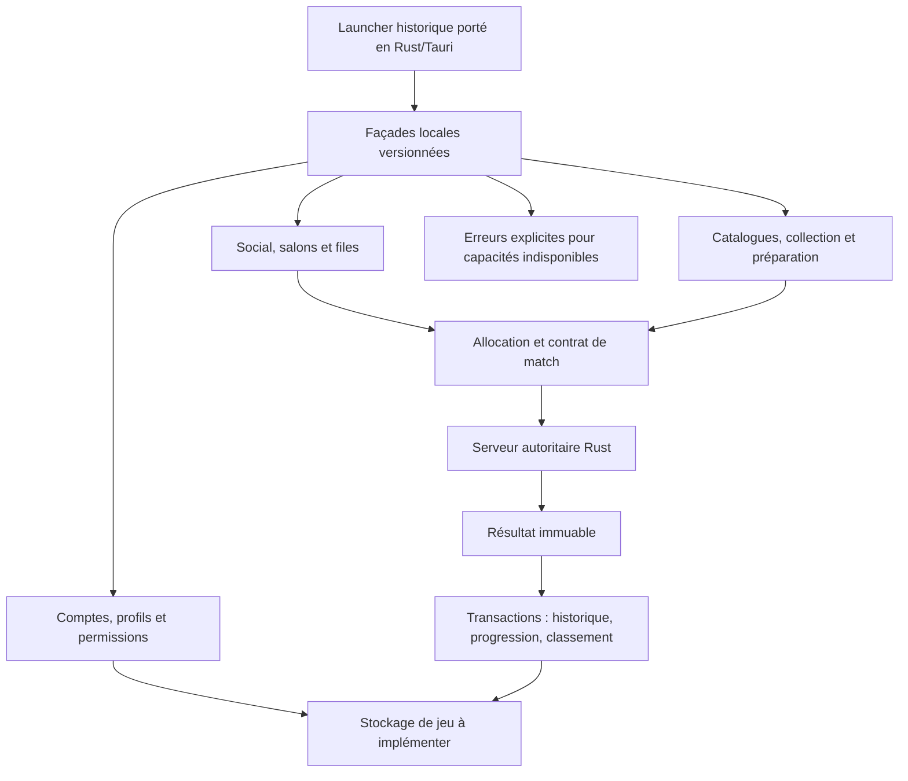

# SYS-01.1-07 — Périmètre des services locaux

Référence : **PUBLIC4.20.0.315, Releases/4.20, EUW/en_GB**, build littéral2014-11-17/17:46:45, fuseau/déploiement non établis ; catalogue4.20.1. ClientAIR **4.20.14_11_18_18_52**, RADS0.0.1.119. Relevé20octobre2026.

Ce document **définit le remplacement fonctionnel local** des services dont les implémentations serveurRiot ne sont pas récupérées dans les références disponibles. Les interfaces, classes et messages du client ont été récupérés ; ils ne constituent pas le code ni les règles internes de ces serveurs. Les services communautaires recensés parSYS03 restent des candidats distincts. Aucune absence globale surInternet ni disparition définitive n’est affirmée.

Le livrable est un contrat de périmètre, intégré à la consigne deSYS-01.1-07 dans le plan. Il n’implémente pas les32 services, ne lance pasAIR/Riot, ne change pas les opérations du moteur et ne prouve aucune disponibilité réseau nouvelle. Les tâches d’implémentation liées restent ouvertes. Le [contrat structuré](reference_local_services_4_20.json), le [reçu de vérification](reference_local_services_4_20_verification.json) et les sources figées dans `reference_local_services_sources/` permettent la relecture.

## Sources, méthode et prérequis

Tâche, ficheD01-SYS-01-1 et phaseD01 : aucune dépendance déclarée. Les entrées nécessaires sont disponibles : référence native, builds, exportsAIR complets et manifeste119, inventaire serveur/clientSYS03, états de sessionSYS06 et code actuel. Les cinq fichiers de la référence native sont revérifiés sans exécuter le binaire. Les218 fichiers retenus pour ce périmètre sont copiés/hachés, dont les interfaces et consommateurs réels. Le code et les preuves préexistants restent conservés.

La recherche parcourt **2877 classes dans les espaces de nomscom.riotgames**, au sein des9139 exports du référentielAIR. Le parseur recense **153 références d’appelsLCDS littéraux**, vers **20 destinations nommées**, et **15 appels avec noms dynamiques**. Les déclarations d’interfaces, commentaires et chaînes contenant du code ne sont pas des appels. Les37 propriétés deServiceProxy incluent36 accès de services et une configuration ; ce n’est pas un décompte de37 serveurs déployés. La surfaceAMF/LCDS observée n’est pas toutes les APIHTTP/XMPP/proxy ni le schéma de production.

`BaseLcdsService` passe destination/opération/arguments àRemoteObject ; sa varianteWithSession préfixe un token de session. Le nomWithoutSession ne prouve pas qu’un serveur accepte une mutation sans autorisation. Les en-têtes, DTO, callbacks et signatures restent des contrats **côté client**. Les appelsLCDSproxy, REST, XMPP, téléchargements et messages asynchrones exigent des adaptateurs propres dans les futures tâches.

## Architecture de remplacement retenue



Les blocs décrivent le périmètre cible ; leur état actuel est détaillé ci-dessous. Aucun nouveau port de production ou transport universel n’est imposé. Les nomsAMF/RTMPS/XMPP/REST historiques guident les fonctions à reproduire ; ils ne sont pas présentés comme des endpointsRust déjà disponibles. Aucun appel vers les anciens hôtes n’est nécessaire à la définition du périmètre.

Décisions : identité et credentials **locaux**, loopback par défaut, pas de compteRiot requis, pas de paiement réel ni de solde officiel simulé. Une monnaie/règle de progression locale doit porter ce statut et sa version. Les algorithmes internes deMMR, matchmaking, anti-abus et certaines récompenses restent inconnus. Aucun nombre plausible ne sera présenté comme une récupération de ces algorithmes. Les contenus absents et capacités non implémentées donnent une indisponibilité explicite, sans succès fictif ni fallbackRiot.

## État réel actuel à conserver

Le launcher n’enregistre que **six commandesTauri** : `roster`, `play`, `join_local`, `session_status`, `resume_session`, `abandon_session`. `roster` lit les définitions ; `play` et`join_local` contrôlent champion et deux choix de sorts parmi ceux autorisés, puis supervisent des processus. Ils ne constituent pas une authentification, une collection de compte, un salon partagé ou une file de matchmaking.

Le lancement possédé force **127.0.0.1:5896** ; le serveur seul peut surcharger son adresse parOPENLEAGUE_SERVER. Loopback est un défaut/politique de lancement, pas une règle de pare-feu globale. Le transport de jeu est du **UDPJSON privé**, incluant version1, session/joueur/epoch, clés de reprise, nonce/séquence et refus nommés. Ce n’est pas une preuve de compatibilité avec le client4.20 ni ses transportsENet/AMF. Une capacité de reprise de match n’est pas une session de compte persistant.

Le serveur a un registre de session, des commandes autoritaires et une persistance de résultats. `result_store::save` synchronise un temporaire et publie un hard-link sans remplacer un document contradictoire : même session/octets = idempotence ; mêmesession/données différentes = refus. `runtime/matches/<session>.json` ne fournit pas à lui seul historique de compte, récompenses transactionnelles ou classement. Aucune qualification de partie à six clients ou de ces services n’est déduite de leur code présent.

**La baseSQLite du plan est exclusivement un suivi de projet.** Elle n’est pas réutilisée comme base des comptes du jeu. Les servicesaudio nommésreplay, les fixtures de boutique, les caches et les seules définitions de champions ne sont pas promus comme services de replay de match, de transactions ou de propriété de contenu.

## Contrats par famille

Chaque famille conserve sa source, ses acquis, son autorité, sa persistance, ses dépendances, ses critères nominaux/refus et les tâches d’implémentation existantes. `not_implemented`, `partial_code_present`, `local_orchestration_present` et`local_content_present` décrivent le périmètre inspecté ; aucune famille n’est déclarée opérationnelle par cette tâche.

### identity — Comptes, authentification et sessions de compte

**Décision :** replace_locally ; **état actuel :** not_implemented.

**Contrat local :** Identité locale stable, création/connexion/déconnexion et expiration ; aucune demande d’identifiants ou jetons Riot.

**Autorité :** Service de comptes local propriétaire des identités et des permissions ; clés de reprise de match distinctes des comptes.

**Persistance :** Comptes, versions de credentials locaux et révocations ; aucune clé sensible dans les journaux.

**Acquis observé dans les sources :** Six commandes Tauri sans commande de connexion de compte ; les capacités de reprise sont limitées à une session de match.

**Cas nominal de future recette :** Compte créé puis reconnecté après redémarrage avec identité stable et session expirée refusée.

**Refus et limites de future recette :** Compte étranger, credentials invalides, session expirée ou opération sans permission : erreur sans mutation.

**Travail restant :** Implémenter et qualifier ce contrat dans les tâches liées ; conserver les acquis listés, sans déduire la disponibilité du service de ce périmètre.

**Dépendances de familles :** persistence, transport.

**Tâches existantes à réaliser :** SYS-19.1-01, SYS-19.1-02, SYS-19.1-03, SYS-19.1-04, SYS-19.1-05, SYS-19.1-06, SYS-19.1-07.

**Sources identifiées :** [air.ServiceProxy](reference_local_services_sources/air/lib__ClientLibServices_dat/scripts/com/riotgames/platform/common/services/ServiceProxy.as), [air.LoginService](reference_local_services_sources/air/lib__ClientLibServices_dat/scripts/com/riotgames/platform/common/services/LoginService.as), [air.AccountManagementService](reference_local_services_sources/air/lib__ClientLibServices_dat/scripts/com/riotgames/platform/gameclient/services/AccountManagementService.as), [air.AccountService](reference_local_services_sources/air/lib__ClientLibServices_dat/scripts/com/riotgames/platform/gameclient/services/AccountService.as), [air.IAuthService](reference_local_services_sources/air/lib__ClientLibServices_dat/scripts/com/riotgames/platform/common/services/IAuthService.as), [air.AccountManagementServiceImpl](reference_local_services_sources/air/mod__ser__mod_ser_dat/scripts/com/riotgames/platform/gameclient/module/services/lcds/AccountManagementServiceImpl.as), [air.AccountServiceImpl](reference_local_services_sources/air/mod__ser__mod_ser_dat/scripts/com/riotgames/platform/gameclient/module/services/lcds/AccountServiceImpl.as), [air.LoginServiceImpl](reference_local_services_sources/air/mod__ser__mod_ser_dat/scripts/com/riotgames/platform/gameclient/module/services/lcds/LoginServiceImpl.as), [current.launcher/src-tauri/src/main.rs](reference_local_services_sources/current/launcher/src-tauri/src/main.rs), [current.crates/server/src/main.rs](reference_local_services_sources/current/crates/server/src/main.rs).

### catalogue — Catalogue et bootstrap du client

**Décision :** replace_locally ; **état actuel :** local_content_present.

**Contrat local :** Publier un catalogue4.20 versionné, cartes/modes/disponibilités, configuration du client et inventaire de ressources ; distinguer définitions, disponibilité et contenu achevé.

**Autorité :** Catalogue local haché et contrats natifs datés ; aucun placeholder présenté comme original complet.

**Persistance :** Versions, provenance et disponibilité des données ; lecture du catalogue non assimilée à une collection de compte.

**Acquis observé dans les sources :** roster lit data/4.20/champions.json ; cela ne prouve ni122 kits terminés ni droits de propriété.

**Cas nominal de future recette :** Le launcher lit le même catalogue identifié que la partie ; entrée absente reste indisponible.

**Refus et limites de future recette :** Version non compatible, entrée inconnue, ressource manquante : refus explicite.

**Travail restant :** Implémenter et qualifier ce contrat dans les tâches liées ; conserver les acquis listés, sans déduire la disponibilité du service de ce périmètre.

**Dépendances de familles :** distribution.

**Tâches existantes à réaliser :** SYS-18.3-01, SYS-18.3-02, SYS-18.3-03, SYS-18.3-04, SYS-18.3-05, SYS-18.3-06, SYS-18.3-07, SYS-18.3-08, SYS-18.3-09, SYS-18.3-10, SYS-18.3-11, SYS-18.3-12.

**Sources identifiées :** [air.ServiceProxy](reference_local_services_sources/air/lib__ClientLibServices_dat/scripts/com/riotgames/platform/common/services/ServiceProxy.as), [air.GameMapService](reference_local_services_sources/air/lib__ClientLibServices_dat/scripts/com/riotgames/platform/gameclient/services/GameMapService.as), [air.LocalGameDataService](reference_local_services_sources/air/lib__ClientLibServices_dat/scripts/com/riotgames/platform/gameclient/services/LocalGameDataService.as), [air.ClientFacadeService](reference_local_services_sources/air/lib__ClientLibServices_dat/scripts/com/riotgames/platform/gameclient/services/ClientFacadeService.as), [air.ClientFacadeServiceImpl](reference_local_services_sources/air/mod__ser__mod_ser_dat/scripts/com/riotgames/platform/gameclient/module/services/lcds/ClientFacadeServiceImpl.as), [air.GameMapServiceImpl](reference_local_services_sources/air/mod__ser__mod_ser_dat/scripts/com/riotgames/platform/gameclient/module/services/lcds/GameMapServiceImpl.as), [air.MicroFeedbackServiceImpl](reference_local_services_sources/air/mod__ser__mod_ser_dat/scripts/com/riotgames/platform/gameclient/module/services/lcds/MicroFeedbackServiceImpl.as), [current.launcher/src-tauri/src/main.rs](reference_local_services_sources/current/launcher/src-tauri/src/main.rs), [current.crates/server/src/main.rs](reference_local_services_sources/current/crates/server/src/main.rs).

### profile — Profil invocateur, icônes et préférences publiques

**Décision :** replace_locally ; **état actuel :** not_implemented.

**Contrat local :** Profil local avec nom, icône, niveau et champs historiques applicables ; lecture publique séparée des informations privées.

**Autorité :** Compte propriétaire ; nom/icône validés par catalogue ; données privées selon permissions.

**Persistance :** Identifiant stable, nom, icône et références de progression.

**Acquis observé dans les sources :** Aucun magasin de profil connecté aux six commandes du launcher actuel.

**Cas nominal de future recette :** Modification autorisée visible après reconnexion, avec séparation public/privé.

**Refus et limites de future recette :** Édition du profil d’autrui, icône invalide ou version obsolète : refus sans effet.

**Travail restant :** Implémenter et qualifier ce contrat dans les tâches liées ; conserver les acquis listés, sans déduire la disponibilité du service de ce périmètre.

**Dépendances de familles :** identity, catalogue.

**Tâches existantes à réaliser :** SYS-19.1-01, SYS-19.1-02, SYS-19.1-03, SYS-19.1-04, SYS-19.1-05, SYS-19.1-06, SYS-19.1-07.

**Sources identifiées :** [air.ServiceProxy](reference_local_services_sources/air/lib__ClientLibServices_dat/scripts/com/riotgames/platform/common/services/ServiceProxy.as), [air.SummonerService](reference_local_services_sources/air/lib__ClientLibServices_dat/scripts/com/riotgames/platform/gameclient/services/SummonerService.as), [air.ClientFacadeService](reference_local_services_sources/air/lib__ClientLibServices_dat/scripts/com/riotgames/platform/gameclient/services/ClientFacadeService.as), [air.SummonerIconService](reference_local_services_sources/air/lib__ClientLibServices_dat/scripts/com/riotgames/platform/gameclient/services/SummonerIconService.as), [air.ClientFacadeServiceImpl](reference_local_services_sources/air/mod__ser__mod_ser_dat/scripts/com/riotgames/platform/gameclient/module/services/lcds/ClientFacadeServiceImpl.as), [air.MicroFeedbackServiceImpl](reference_local_services_sources/air/mod__ser__mod_ser_dat/scripts/com/riotgames/platform/gameclient/module/services/lcds/MicroFeedbackServiceImpl.as), [air.SummonerIconServiceImpl](reference_local_services_sources/air/mod__ser__mod_ser_dat/scripts/com/riotgames/platform/gameclient/module/services/lcds/SummonerIconServiceImpl.as), [air.SummonerServiceImpl](reference_local_services_sources/air/mod__ser__mod_ser_dat/scripts/com/riotgames/platform/gameclient/module/services/lcds/SummonerServiceImpl.as), [current.launcher/src-tauri/src/main.rs](reference_local_services_sources/current/launcher/src-tauri/src/main.rs), [current.crates/server/src/main.rs](reference_local_services_sources/current/crates/server/src/main.rs).

### collections — Champions, skins, pages et déblocages

**Décision :** replace_locally ; **état actuel :** not_implemented.

**Contrat local :** Collection locale persistante et politique de déblocage explicite ; disponibilité des assets séparée des droits locaux.

**Autorité :** Service de collection ; les octets importés ne confèrent pas une propriété officielle Riot.

**Persistance :** Déblocages, sources d’attribution et révisions transactionnelles.

**Acquis observé dans les sources :** Catalogue de définitions présent ; aucune collection persistante de compte exposée par le launcher.

**Cas nominal de future recette :** Déblocage conservé après restauration et consommé par la sélection du même compte.

**Refus et limites de future recette :** Contenu absent, opération non autorisée ou attribution déjà appliquée : erreur/idempotence, aucun double gain.

**Travail restant :** Implémenter et qualifier ce contrat dans les tâches liées ; conserver les acquis listés, sans déduire la disponibilité du service de ce périmètre.

**Dépendances de familles :** identity, catalogue.

**Tâches existantes à réaliser :** SYS-19.2-01, SYS-19.2-02, SYS-19.2-03, SYS-19.2-04, SYS-19.2-05, SYS-19.2-06, SYS-19.2-07, SYS-19.2-08.

**Sources identifiées :** [air.ServiceProxy](reference_local_services_sources/air/lib__ClientLibServices_dat/scripts/com/riotgames/platform/common/services/ServiceProxy.as), [air.InventoryService](reference_local_services_sources/air/lib__ClientLibServices_dat/scripts/com/riotgames/platform/common/services/InventoryService.as), [air.InventoryServiceImpl](reference_local_services_sources/air/mod__ser__mod_ser_dat/scripts/com/riotgames/platform/gameclient/module/services/lcds/InventoryServiceImpl.as), [current.launcher/src-tauri/src/main.rs](reference_local_services_sources/current/launcher/src-tauri/src/main.rs), [current.crates/server/src/main.rs](reference_local_services_sources/current/crates/server/src/main.rs).

### loadouts — Pages de runes, maîtrises et sorts invocateur

**Décision :** replace_locally ; **état actuel :** partial_code_present.

**Contrat local :** Pages et choix par compte, validation de budget/rangs/exclusivité et transfert d’un loadout complet au match.

**Autorité :** Service de préparation propriétaire de la page ; validation autoritaire côté allocation/serveur.

**Persistance :** Pages, choix actifs et versions de règles ; pas de simple état navigateur.

**Acquis observé dans les sources :** play/join_local valident seulement cinq sorts nommés et doublons ; transfert JSON de deux choix ; pages complètes non intégrées.

**Cas nominal de future recette :** Même page validée avant lancement et appliquée au joueur de la partie correspondante.

**Refus et limites de future recette :** Rangs/budget illégaux, page étrangère ou sorts doublés/non implémentés : refus.

**Travail restant :** Implémenter et qualifier ce contrat dans les tâches liées ; conserver les acquis listés, sans déduire la disponibilité du service de ce périmètre.

**Dépendances de familles :** collections, profile.

**Tâches existantes à réaliser :** SYS-18.6-01, SYS-18.6-02, SYS-18.6-03, SYS-18.6-04, SYS-18.6-05, SYS-18.6-06, SYS-18.6-07.

**Sources identifiées :** [air.ServiceProxy](reference_local_services_sources/air/lib__ClientLibServices_dat/scripts/com/riotgames/platform/common/services/ServiceProxy.as), [air.SpellBookService](reference_local_services_sources/air/lib__ClientLibServices_dat/scripts/com/riotgames/platform/gameclient/services/SpellBookService.as), [air.MasteryBookService](reference_local_services_sources/air/lib__ClientLibServices_dat/scripts/com/riotgames/platform/gameclient/services/MasteryBookService.as), [air.SummonerRuneService](reference_local_services_sources/air/lib__ClientLibServices_dat/scripts/com/riotgames/platform/gameclient/services/SummonerRuneService.as), [air.MasteryBookServiceImpl](reference_local_services_sources/air/mod__ser__mod_ser_dat/scripts/com/riotgames/platform/gameclient/module/services/lcds/MasteryBookServiceImpl.as), [air.SpellBookServiceImpl](reference_local_services_sources/air/mod__ser__mod_ser_dat/scripts/com/riotgames/platform/gameclient/module/services/lcds/SpellBookServiceImpl.as), [air.SummonerRuneServiceImpl](reference_local_services_sources/air/mod__ser__mod_ser_dat/scripts/com/riotgames/platform/gameclient/module/services/lcds/SummonerRuneServiceImpl.as), [current.launcher/src-tauri/src/main.rs](reference_local_services_sources/current/launcher/src-tauri/src/main.rs), [current.crates/server/src/main.rs](reference_local_services_sources/current/crates/server/src/main.rs).

### preferences — Options et raccourcis du compte

**Décision :** replace_locally ; **état actuel :** not_implemented.

**Contrat local :** Sauvegarder options, raccourcis et paramètres client applicables, versionnés et validés.

**Autorité :** Compte propriétaire ; schéma local des préférences et limites de valeurs.

**Persistance :** Préférences et migrations de schéma.

**Acquis observé dans les sources :** Aucun service de préférences de compte relié aux six commandes du launcher.

**Cas nominal de future recette :** Options restaurées après redémarrage et appliquées par le consommateur réel.

**Refus et limites de future recette :** Valeur hors bornes, clé inconnue ou profil étranger : refus, conservation des dernières valeurs valides.

**Travail restant :** Implémenter et qualifier ce contrat dans les tâches liées ; conserver les acquis listés, sans déduire la disponibilité du service de ce périmètre.

**Dépendances de familles :** identity.

**Tâches existantes à réaliser :** SYS-18.3-01, SYS-18.3-02, SYS-18.3-03, SYS-18.3-04, SYS-18.3-05, SYS-18.3-06, SYS-18.3-07, SYS-18.3-08, SYS-18.3-09, SYS-18.3-10, SYS-18.3-11, SYS-18.3-12.

**Sources identifiées :** [air.ServiceProxy](reference_local_services_sources/air/lib__ClientLibServices_dat/scripts/com/riotgames/platform/common/services/ServiceProxy.as), [air.PlayerPreferencesService](reference_local_services_sources/air/lib__ClientLibServices_dat/scripts/com/riotgames/platform/gameclient/services/PlayerPreferencesService.as), [air.PlayerPreferencesServiceImpl](reference_local_services_sources/air/mod__ser__mod_ser_dat/scripts/com/riotgames/platform/gameclient/module/services/lcds/PlayerPreferencesServiceImpl.as), [current.launcher/src-tauri/src/main.rs](reference_local_services_sources/current/launcher/src-tauri/src/main.rs), [current.crates/server/src/main.rs](reference_local_services_sources/current/crates/server/src/main.rs).

### social — Amis, blocages et présence

**Décision :** replace_locally ; **état actuel :** not_implemented.

**Contrat local :** Relations d’amitié, invitations, blocages et présence locale, avec audiences autorisées.

**Autorité :** Chaque compte contrôle ses relations ; aucune présence d’un compte bloqué/non autorisé divulguée.

**Persistance :** Demandes, relations, blocages ; présence éphémère avec expiration.

**Acquis observé dans les sources :** ChatService/XMPP décrit le contrat client historique ; aucun service social de compte actuel n’est exposé.

**Cas nominal de future recette :** Deux comptes locaux échangent et restaurent une relation et les changements autorisés de présence.

**Refus et limites de future recette :** Auto-invitation, relation bloquée, compte inconnu, audience interdite : refus sans fuite.

**Travail restant :** Implémenter et qualifier ce contrat dans les tâches liées ; conserver les acquis listés, sans déduire la disponibilité du service de ce périmètre.

**Dépendances de familles :** identity.

**Tâches existantes à réaliser :** SYS-19.3-01, SYS-19.3-02, SYS-19.3-03, SYS-19.3-04, SYS-19.3-05, SYS-19.3-06, SYS-19.3-07, SYS-19.3-08.

**Sources identifiées :** [air.ServiceProxy](reference_local_services_sources/air/lib__ClientLibServices_dat/scripts/com/riotgames/platform/common/services/ServiceProxy.as), [air.ChatService](reference_local_services_sources/air/lib__ClientLibServices_dat/scripts/com/riotgames/platform/common/services/ChatService.as), [current.launcher/src-tauri/src/main.rs](reference_local_services_sources/current/launcher/src-tauri/src/main.rs), [current.crates/server/src/main.rs](reference_local_services_sources/current/crates/server/src/main.rs).

### chat — Messages privés, d’équipe et salons

**Décision :** replace_locally ; **état actuel :** not_implemented.

**Contrat local :** Messages locaux routés selon destinataires, appartenance, blocages et limites de taille/fréquence/historique.

**Autorité :** Serveur de messages local ; aucune confiance dans une audience ou identité choisie librement par le client.

**Persistance :** Rétention locale documentée ; historique privé soumis aux permissions.

**Acquis observé dans les sources :** Aucune commande de chat dans le launcher ou les variantes du transport de jeu inspectées.

**Cas nominal de future recette :** Message reçu uniquement par les destinataires autorisés, y compris après reprise du salon.

**Refus et limites de future recette :** Salon privé inaccessible, débit/taille dépassés, expéditeur usurpé : refus ; pas d’envoi Riot/XMPP distant.

**Travail restant :** Implémenter et qualifier ce contrat dans les tâches liées ; conserver les acquis listés, sans déduire la disponibilité du service de ce périmètre.

**Dépendances de familles :** social.

**Tâches existantes à réaliser :** SYS-19.3-01, SYS-19.3-02, SYS-19.3-03, SYS-19.3-04, SYS-19.3-05, SYS-19.3-06, SYS-19.3-07, SYS-19.3-08.

**Sources identifiées :** [air.ServiceProxy](reference_local_services_sources/air/lib__ClientLibServices_dat/scripts/com/riotgames/platform/common/services/ServiceProxy.as), [air.ChatService](reference_local_services_sources/air/lib__ClientLibServices_dat/scripts/com/riotgames/platform/common/services/ChatService.as), [current.launcher/src-tauri/src/main.rs](reference_local_services_sources/current/launcher/src-tauri/src/main.rs), [current.crates/server/src/main.rs](reference_local_services_sources/current/crates/server/src/main.rs).

### party — Groupes, salons de préparation et invitations

**Décision :** replace_locally ; **état actuel :** not_implemented.

**Contrat local :** Salons possédés, invitations/exclusions, équipes et places, mode/carte, fermeture et reprise.

**Autorité :** Propriétaire/participants selon permissions ; version monotone du salon.

**Persistance :** Salons/invitations nécessaires à la reprise, expiration et clôture des orphelins.

**Acquis observé dans les sources :** Lancement de processus direct présent ; aucun salon multi-compte persistant exposé.

**Cas nominal de future recette :** Invitation acceptée une fois, joueur placé dans un seul salon compatible et état commun aux participants.

**Refus et limites de future recette :** Salon plein, invitation expirée, propriétaire absent, mauvais compte ou doubles appartenances : refus.

**Travail restant :** Implémenter et qualifier ce contrat dans les tâches liées ; conserver les acquis listés, sans déduire la disponibilité du service de ce périmètre.

**Dépendances de familles :** identity, social, catalogue.

**Tâches existantes à réaliser :** SYS-19.3-01, SYS-19.3-02, SYS-19.3-03, SYS-19.3-04, SYS-19.3-05, SYS-19.3-06, SYS-19.3-07, SYS-19.3-08.

**Sources identifiées :** [air.ServiceProxy](reference_local_services_sources/air/lib__ClientLibServices_dat/scripts/com/riotgames/platform/common/services/ServiceProxy.as), [air.GameService](reference_local_services_sources/air/lib__ClientLibServices_dat/scripts/com/riotgames/platform/gameclient/services/GameService.as), [air.GameInviteService](reference_local_services_sources/air/lib__ClientLibServices_dat/scripts/com/riotgames/platform/common/services/GameInviteService.as), [air.GameInviteServiceImpl](reference_local_services_sources/air/mod__ser__mod_ser_dat/scripts/com/riotgames/platform/gameclient/module/services/lcds/GameInviteServiceImpl.as), [air.GameServiceImpl](reference_local_services_sources/air/mod__ser__mod_ser_dat/scripts/com/riotgames/platform/gameclient/module/services/lcds/GameServiceImpl.as), [current.launcher/src-tauri/src/main.rs](reference_local_services_sources/current/launcher/src-tauri/src/main.rs), [current.crates/server/src/main.rs](reference_local_services_sources/current/crates/server/src/main.rs).

### queues — Files, acceptation, annulation et restrictions

**Décision :** replace_locally ; **état actuel :** not_implemented.

**Contrat local :** File locale par mode/groupe, acceptation bornée, annulation, absents et restrictions explicites ; pas d’algorithme Riot supposé.

**Autorité :** Service de file local et horloge serveur ; version/idempotence des tickets.

**Persistance :** Tickets, décisions d’acceptation et expiration ; pas de joueurs fantômes après panne.

**Acquis observé dans les sources :** join_local rejoint un endpoint fixe ; cela n’implémente pas matchmakerService.

**Cas nominal de future recette :** Groupes compatibles alloués une fois ; annulation/timeout retirent les participants.

**Refus et limites de future recette :** Ticket doublé, groupe modifié, restriction ou capacité incompatible : erreur sans allocation partielle.

**Travail restant :** Implémenter et qualifier ce contrat dans les tâches liées ; conserver les acquis listés, sans déduire la disponibilité du service de ce périmètre.

**Dépendances de familles :** party.

**Tâches existantes à réaliser :** SYS-19.4-01, SYS-19.4-02, SYS-19.4-03, SYS-19.4-04, SYS-19.4-05, SYS-19.4-06, SYS-19.4-07, SYS-19.4-08.

**Sources identifiées :** [air.ServiceProxy](reference_local_services_sources/air/lib__ClientLibServices_dat/scripts/com/riotgames/platform/common/services/ServiceProxy.as), [air.QueueRestrictionService](reference_local_services_sources/air/lib__ClientLibServices_dat/scripts/com/riotgames/platform/common/services/QueueRestrictionService.as), [air.MatchMakerService](reference_local_services_sources/air/lib__ClientLibServices_dat/scripts/com/riotgames/platform/gameclient/services/MatchMakerService.as), [air.MatchMakerServiceImpl](reference_local_services_sources/air/mod__ser__mod_ser_dat/scripts/com/riotgames/platform/gameclient/module/services/lcds/MatchMakerServiceImpl.as), [air.QueueRestrictionServiceImpl](reference_local_services_sources/air/mod__ser__mod_ser_dat/scripts/com/riotgames/platform/gameclient/module/services/lcds/QueueRestrictionServiceImpl.as), [current.launcher/src-tauri/src/main.rs](reference_local_services_sources/current/launcher/src-tauri/src/main.rs), [current.crates/server/src/main.rs](reference_local_services_sources/current/crates/server/src/main.rs).

### team_builder — Team Builder/CAP

**Décision :** replace_locally ; **état actuel :** not_implemented.

**Contrat local :** PérimètreCAP4.20 conservé : rôles, groupe, propositions et annulation ; spécifier les règles locales avant implémentation.

**Autorité :** ServiceCAP local et contraintes de mode ; aucune disponibilité de service historique déduite des modules.

**Persistance :** Intentions de rôle/groupe et tickets selon contrat local documenté.

**Acquis observé dans les sources :** ModuleCAP original présent ; aucun serviceCAP local exposé par les consommateurs actuels.

**Cas nominal de future recette :** ParcoursCAP applicable aboutit à un salon et une allocation cohérents dans le système local.

**Refus et limites de future recette :** Mode non pris en charge, groupe obsolète ou contrat serveur inconnu : indisponibilité explicite, pas de faux succès.

**Travail restant :** Implémenter et qualifier ce contrat dans les tâches liées ; conserver les acquis listés, sans déduire la disponibilité du service de ce périmètre.

**Dépendances de familles :** party, profile.

**Tâches existantes à réaliser :** SYS-19.4-01, SYS-19.4-02, SYS-19.4-03, SYS-19.4-04, SYS-19.4-05, SYS-19.4-06, SYS-19.4-07, SYS-19.4-08.

**Sources identifiées :** [air.ServiceProxy](reference_local_services_sources/air/lib__ClientLibServices_dat/scripts/com/riotgames/platform/common/services/ServiceProxy.as), [current.launcher/src-tauri/src/main.rs](reference_local_services_sources/current/launcher/src-tauri/src/main.rs), [current.crates/server/src/main.rs](reference_local_services_sources/current/crates/server/src/main.rs), [air.CapLcdsMessageRouter](reference_local_services_sources/air/mod__cap__mod_cap_dat/scripts/com/riotgames/pvpnet/cap/services/CapLcdsMessageRouter.as).

### selection — Sélection, bans, échanges et rerolls

**Décision :** replace_locally ; **état actuel :** partial_code_present.

**Contrat local :** Automate de sélection partagé, tours/délais, bans, skins, échanges et rerolls selon mode ; la sélection locale directe reste distincte.

**Autorité :** Coordinateur serveur, propriétaire du joueur et permissions de contenu.

**Persistance :** Snapshot de préparation, version, décisions et clôture ; points de reroll liés à progression.

**Acquis observé dans les sources :** Champion connu et deux sorts choisis transmis au processus ; aucun draft partagé/bans/échanges complet.

**Cas nominal de future recette :** Participants voient la même sélection puis un contrat final identique ; échange/reroll appliqué une fois.

**Refus et limites de future recette :** Tour expiré, contenu interdit, échange non accepté ou mode incompatible : refus sans permutation.

**Travail restant :** Implémenter et qualifier ce contrat dans les tâches liées ; conserver les acquis listés, sans déduire la disponibilité du service de ce périmètre.

**Dépendances de familles :** party, loadouts, queues.

**Tâches existantes à réaliser :** SYS-18.4-01, SYS-18.4-02, SYS-18.4-03, SYS-18.4-04, SYS-18.4-05, SYS-18.4-06, SYS-18.4-07, SYS-18.4-08.

**Sources identifiées :** [air.ServiceProxy](reference_local_services_sources/air/lib__ClientLibServices_dat/scripts/com/riotgames/platform/common/services/ServiceProxy.as), [air.RerollService](reference_local_services_sources/air/lib__ClientLibServices_dat/scripts/com/riotgames/platform/common/services/RerollService.as), [air.GameService](reference_local_services_sources/air/lib__ClientLibServices_dat/scripts/com/riotgames/platform/gameclient/services/GameService.as), [air.IChampionTradeService](reference_local_services_sources/air/lib__ClientLibServices_dat/scripts/com/riotgames/platform/gameclient/services/trade/IChampionTradeService.as), [air.GameServiceImpl](reference_local_services_sources/air/mod__ser__mod_ser_dat/scripts/com/riotgames/platform/gameclient/module/services/lcds/GameServiceImpl.as), [air.RerollServiceImpl](reference_local_services_sources/air/mod__ser__mod_ser_dat/scripts/com/riotgames/platform/gameclient/module/services/lcds/RerollServiceImpl.as), [current.launcher/src-tauri/src/main.rs](reference_local_services_sources/current/launcher/src-tauri/src/main.rs), [current.crates/server/src/main.rs](reference_local_services_sources/current/crates/server/src/main.rs).

### allocation — Allocation et contrat de lancement

**Décision :** replace_locally ; **état actuel :** local_orchestration_present.

**Contrat local :** Allouer une session avec carte/mode/équipes/places/loadouts et credentials locaux ; aucun ticket Riot généré.

**Autorité :** Allocateurréservant tous les participants ; superviseur possède seulement ses processus.

**Persistance :** Allocation, réservations et statut de lancement ; secrets isolés des logs.

**Acquis observé dans les sources :** Superviseur Rust sur127.0.0.1:5896, clés/nonce par canal privé ; pas d’allocation de file complète à six joueurs qualifiée.

**Cas nominal de future recette :** Allocation unique, contrat cohérent chez tous les clients, absents et échec de spawn traités.

**Refus et limites de future recette :** Contrat incomplet, endpoint non autorisé, place déjà prise ou capacité absente : refus avant allocation irréversible.

**Travail restant :** Implémenter et qualifier ce contrat dans les tâches liées ; conserver les acquis listés, sans déduire la disponibilité du service de ce périmètre.

**Dépendances de familles :** selection, transport.

**Tâches existantes à réaliser :** SYS-19.4-01, SYS-19.4-02, SYS-19.4-03, SYS-19.4-04, SYS-19.4-05, SYS-19.4-06, SYS-19.4-07, SYS-19.4-08.

**Sources identifiées :** [air.ServiceProxy](reference_local_services_sources/air/lib__ClientLibServices_dat/scripts/com/riotgames/platform/common/services/ServiceProxy.as), [air.GameService](reference_local_services_sources/air/lib__ClientLibServices_dat/scripts/com/riotgames/platform/gameclient/services/GameService.as), [air.GameZoneGameService](reference_local_services_sources/air/lib__ClientLibServices_dat/scripts/com/riotgames/platform/gameclient/services/GameZoneGameService.as), [air.GameServiceImpl](reference_local_services_sources/air/mod__ser__mod_ser_dat/scripts/com/riotgames/platform/gameclient/module/services/lcds/GameServiceImpl.as), [current.launcher/src-tauri/src/main.rs](reference_local_services_sources/current/launcher/src-tauri/src/main.rs), [current.crates/server/src/main.rs](reference_local_services_sources/current/crates/server/src/main.rs).

### sessions — Session de match, reprise et retour

**Décision :** adapt_locally ; **état actuel :** partial_code_present.

**Contrat local :** Relier compte/allocation au lease de match, reprise de la même identité, révocation, fin et retour ; distinguer session de compte et clé de match.

**Autorité :** Registre serveur et propriétaire de la réservation ; session/player/epoch/nonce validés.

**Persistance :** Durabilité de compte/allocation future ; registre de reprise actuel en mémoire.

**Acquis observé dans les sources :** Registry/Host/session_transport et superviseur présents ; association à un compte persistant et compatibilité native non qualifiées.

**Cas nominal de future recette :** Même joueur reprend sans nouveauJoin et revient au launcher avec résultat/Leave cohérents.

**Refus et limites de future recette :** Mauvaise clé, séquence, epoch, session périmée ou drain : rejet explicite sans fuite.

**Travail restant :** Implémenter et qualifier ce contrat dans les tâches liées ; conserver les acquis listés, sans déduire la disponibilité du service de ce périmètre.

**Dépendances de familles :** identity, transport.

**Tâches existantes à réaliser :** SYS-20.3-01, SYS-20.3-02, SYS-20.3-03, SYS-20.3-04, SYS-20.3-05, SYS-20.3-06.

**Sources identifiées :** [air.ServiceProxy](reference_local_services_sources/air/lib__ClientLibServices_dat/scripts/com/riotgames/platform/common/services/ServiceProxy.as), [air.GameService](reference_local_services_sources/air/lib__ClientLibServices_dat/scripts/com/riotgames/platform/gameclient/services/GameService.as), [air.MaestroService](reference_local_services_sources/air/lib__ClientLibServices_dat/scripts/com/riotgames/platform/gameclient/services/maestro/MaestroService.as), [air.GameZoneGameService](reference_local_services_sources/air/lib__ClientLibServices_dat/scripts/com/riotgames/platform/gameclient/services/GameZoneGameService.as), [air.GameServiceImpl](reference_local_services_sources/air/mod__ser__mod_ser_dat/scripts/com/riotgames/platform/gameclient/module/services/lcds/GameServiceImpl.as), [current.launcher/src-tauri/src/main.rs](reference_local_services_sources/current/launcher/src-tauri/src/main.rs), [current.crates/server/src/main.rs](reference_local_services_sources/current/crates/server/src/main.rs).

### game_authority — Serveur autoritaire de partie

**Décision :** adapt_locally ; **état actuel :** partial_code_present.

**Contrat local :** Simulation Rust, commandes validées, vision et snapshots privés ; séparation des services de compte/préparation.

**Autorité :** Serveur de partie propriétaire du temps, des entités et des résultats.

**Persistance :** Résultat final ; états/replay durables selon tâches dédiées, pas un compte inventé.

**Acquis observé dans les sources :** ServeurUDP JSON privé présent ; ni backend Riot récupéré ni compatibilitéENet/AMF4.20 établie.

**Cas nominal de future recette :** Commandes attribuées au bon joueur et résultats identiques pour les clients autorisés.

**Refus et limites de future recette :** Commande inconnue, joueur étranger, version/séquence invalide : erreur explicite sans effet non autorisé.

**Travail restant :** Implémenter et qualifier ce contrat dans les tâches liées ; conserver les acquis listés, sans déduire la disponibilité du service de ce périmètre.

**Dépendances de familles :** transport.

**Tâches existantes à réaliser :** SYS-20.1-01, SYS-20.1-02, SYS-20.1-03, SYS-20.1-04, SYS-20.1-05, SYS-20.1-06, SYS-20.1-07, SYS-20.1-08.

**Sources identifiées :** [air.ServiceProxy](reference_local_services_sources/air/lib__ClientLibServices_dat/scripts/com/riotgames/platform/common/services/ServiceProxy.as), [current.launcher/src-tauri/src/main.rs](reference_local_services_sources/current/launcher/src-tauri/src/main.rs), [current.crates/server/src/main.rs](reference_local_services_sources/current/crates/server/src/main.rs).

### results — Résultats, statistiques et historique

**Décision :** adapt_locally ; **état actuel :** partial_code_present.

**Contrat local :** Consommer un résultat serveur immuable, indexer l’historique du compte et notifier le launcher, sans réécrire une partie passée.

**Autorité :** Résultat autoritaire et participants figés ; données privées selon compte/audience.

**Persistance :** Fichiersruntime/matches actuels puis index de compte transactionnel à intégrer.

**Acquis observé dans les sources :** result_store utilise écriture synchronisée et hard-link sans écrasement ; aucun historique de compte complet ni récompense automatique prouvé.

**Cas nominal de future recette :** Fin publiée une fois, relue après redémarrage ; même session/données idempotentes.

**Refus et limites de future recette :** Résultat contradictoire, fichier invalide, compte étranger ou écriture échouée : refus sans faux gain.

**Travail restant :** Implémenter et qualifier ce contrat dans les tâches liées ; conserver les acquis listés, sans déduire la disponibilité du service de ce périmètre.

**Dépendances de familles :** game_authority, persistence.

**Tâches existantes à réaliser :** SYS-19.2-01, SYS-19.2-02, SYS-19.2-03, SYS-19.2-04, SYS-19.2-05, SYS-19.2-06, SYS-19.2-07, SYS-19.2-08.

**Sources identifiées :** [air.ServiceProxy](reference_local_services_sources/air/lib__ClientLibServices_dat/scripts/com/riotgames/platform/common/services/ServiceProxy.as), [air.PlayerStatsService](reference_local_services_sources/air/lib__ClientLibServices_dat/scripts/com/riotgames/platform/gameclient/services/PlayerStatsService.as), [air.PlayerStatsServiceImpl](reference_local_services_sources/air/mod__ser__mod_ser_dat/scripts/com/riotgames/platform/gameclient/module/services/lcds/PlayerStatsServiceImpl.as), [current.launcher/src-tauri/src/main.rs](reference_local_services_sources/current/launcher/src-tauri/src/main.rs), [current.crates/server/src/main.rs](reference_local_services_sources/current/crates/server/src/main.rs), [current.crates/server/src/result_store.rs](reference_local_services_sources/current/crates/server/src/result_store.rs).

### progression — Expérience, niveaux et récompenses

**Décision :** replace_locally ; **état actuel :** not_implemented.

**Contrat local :** Règles locales versionnées pour expérience, niveaux, points et récompenses, comparées aux valeurs4.20 récupérées ; inconnues Riot nommées.

**Autorité :** Service de progression consomme seulement les résultats validés et non encore attribués.

**Persistance :** Ledger idempotent, niveaux, soldes et version de règle dans une transaction.

**Acquis observé dans les sources :** Progression de niveau du champion en partie distincte du niveau et des récompenses du compte, non exposés actuellement.

**Cas nominal de future recette :** Une partie donne une attribution unique même après reprise d’écriture ou restauration.

**Refus et limites de future recette :** Résultat non validé, déjà attribué ou règle inconnue : aucune récompense silencieuse.

**Travail restant :** Implémenter et qualifier ce contrat dans les tâches liées ; conserver les acquis listés, sans déduire la disponibilité du service de ce périmètre.

**Dépendances de familles :** results, identity.

**Tâches existantes à réaliser :** SYS-19.2-01, SYS-19.2-02, SYS-19.2-03, SYS-19.2-04, SYS-19.2-05, SYS-19.2-06, SYS-19.2-07, SYS-19.2-08.

**Sources identifiées :** [air.ServiceProxy](reference_local_services_sources/air/lib__ClientLibServices_dat/scripts/com/riotgames/platform/common/services/ServiceProxy.as), [air.RerollService](reference_local_services_sources/air/lib__ClientLibServices_dat/scripts/com/riotgames/platform/common/services/RerollService.as), [air.SummonerService](reference_local_services_sources/air/lib__ClientLibServices_dat/scripts/com/riotgames/platform/gameclient/services/SummonerService.as), [air.RerollServiceImpl](reference_local_services_sources/air/mod__ser__mod_ser_dat/scripts/com/riotgames/platform/gameclient/module/services/lcds/RerollServiceImpl.as), [air.SummonerServiceImpl](reference_local_services_sources/air/mod__ser__mod_ser_dat/scripts/com/riotgames/platform/gameclient/module/services/lcds/SummonerServiceImpl.as), [current.launcher/src-tauri/src/main.rs](reference_local_services_sources/current/launcher/src-tauri/src/main.rs), [current.crates/server/src/main.rs](reference_local_services_sources/current/crates/server/src/main.rs).

### teams — Équipes classées historiques

**Décision :** replace_locally ; **état actuel :** not_implemented.

**Contrat local :** Équipe locale, propriétaire, membres, invitations et historique pour le périmètre classé4.20 applicable.

**Autorité :** Permissions du propriétaire/membres et contraintes du mode.

**Persistance :** Identité d’équipe, roster, invitations et résultats associés.

**Acquis observé dans les sources :** summonerTeamService n’a pas d’équivalent de compte/équipe local actuellement exposé.

**Cas nominal de future recette :** Création/adhésion/retour persistants et cohérents avec file et résultat.

**Refus et limites de future recette :** Équipe pleine, membre non invité, joueur inéligible ou modification sans permission : refus.

**Travail restant :** Implémenter et qualifier ce contrat dans les tâches liées ; conserver les acquis listés, sans déduire la disponibilité du service de ce périmètre.

**Dépendances de familles :** identity, social.

**Tâches existantes à réaliser :** SYS-19.5-01, SYS-19.5-02, SYS-19.5-03, SYS-19.5-04, SYS-19.5-05, SYS-19.5-06, SYS-19.5-07.

**Sources identifiées :** [air.ServiceProxy](reference_local_services_sources/air/lib__ClientLibServices_dat/scripts/com/riotgames/platform/common/services/ServiceProxy.as), [air.TeamService](reference_local_services_sources/air/lib__ClientLibServices_dat/scripts/com/riotgames/platform/gameclient/services/TeamService.as), [air.TeamServiceImpl](reference_local_services_sources/air/mod__ser__mod_ser_dat/scripts/com/riotgames/platform/gameclient/module/services/lcds/TeamServiceImpl.as), [current.launcher/src-tauri/src/main.rs](reference_local_services_sources/current/launcher/src-tauri/src/main.rs), [current.crates/server/src/main.rs](reference_local_services_sources/current/crates/server/src/main.rs).

### leagues — Classement, ligues et placements locaux

**Décision :** replace_locally ; **état actuel :** not_implemented.

**Contrat local :** Système local explicitement nommé : divisions, points, placements/séries/décroissance à spécifier ; MMR interne Riot non récupéré.

**Autorité :** Règle de classement locale versionnée, résultats autoritaires et éligibilité vérifiée.

**Persistance :** Points/divisions/séries et ledger de résultats appliqués une fois.

**Acquis observé dans les sources :** InterfacesCLSServicePlatform récupérées ; algorithme serveur et service local absents du périmètre exécuté.

**Cas nominal de future recette :** Rejeu de résultats et restauration ne modifient pas une seconde fois le classement.

**Refus et limites de future recette :** Règle non définie ou résultat contradictoire : classement indisponible, aucune valeur Riot inventée.

**Travail restant :** Implémenter et qualifier ce contrat dans les tâches liées ; conserver les acquis listés, sans déduire la disponibilité du service de ce périmètre.

**Dépendances de familles :** results, teams.

**Tâches existantes à réaliser :** SYS-19.5-01, SYS-19.5-02, SYS-19.5-03, SYS-19.5-04, SYS-19.5-05, SYS-19.5-06, SYS-19.5-07.

**Sources identifiées :** [air.ServiceProxy](reference_local_services_sources/air/lib__ClientLibServices_dat/scripts/com/riotgames/platform/common/services/ServiceProxy.as), [air.CLSServicePlatform](reference_local_services_sources/air/lib__ClientLibServices_dat/scripts/com/riotgames/platform/gameclient/services/CLSServicePlatform.as), [current.launcher/src-tauri/src/main.rs](reference_local_services_sources/current/launcher/src-tauri/src/main.rs), [current.crates/server/src/main.rs](reference_local_services_sources/current/crates/server/src/main.rs).

### store — Boutique locale et catalogue commercial

**Décision :** replace_locally ; **état actuel :** not_implemented.

**Contrat local :** Boutique locale reproduisant les parcours applicables avec catalogue/provenance/versions ; aucune boutique Riot distante par défaut.

**Autorité :** Service de catalogue local ; mutation de collection uniquement par transaction économique autorisée.

**Persistance :** Catalogue, offres datées et état local des achats/déblocages.

**Acquis observé dans les sources :** StoreView/StoreCatalogDao décrivent le client/HTML ; aucune boutique persistante locale reliée au launcher actuel.

**Cas nominal de future recette :** Consultation locale, prix/règles identifiés, erreurs d’indisponibilité sans chargement distant implicite.

**Refus et limites de future recette :** Offre inconnue, prix non qualifié ou session expirée : refus explicite ; aucun succès d’achat fictif.

**Travail restant :** Implémenter et qualifier ce contrat dans les tâches liées ; conserver les acquis listés, sans déduire la disponibilité du service de ce périmètre.

**Dépendances de familles :** catalogue, identity.

**Tâches existantes à réaliser :** SYS-18.3-01, SYS-18.3-02, SYS-18.3-03, SYS-18.3-04, SYS-18.3-05, SYS-18.3-06, SYS-18.3-07, SYS-18.3-08, SYS-18.3-09, SYS-18.3-10, SYS-18.3-11, SYS-18.3-12.

**Sources identifiées :** [air.ServiceProxy](reference_local_services_sources/air/lib__ClientLibServices_dat/scripts/com/riotgames/platform/common/services/ServiceProxy.as), [air.RESTService](reference_local_services_sources/air/lib__ClientLibServices_dat/scripts/com/riotgames/platform/common/services/RESTService.as), [air.ClientFacadeService](reference_local_services_sources/air/lib__ClientLibServices_dat/scripts/com/riotgames/platform/gameclient/services/ClientFacadeService.as), [air.ClientFacadeServiceImpl](reference_local_services_sources/air/mod__ser__mod_ser_dat/scripts/com/riotgames/platform/gameclient/module/services/lcds/ClientFacadeServiceImpl.as), [air.MicroFeedbackServiceImpl](reference_local_services_sources/air/mod__ser__mod_ser_dat/scripts/com/riotgames/platform/gameclient/module/services/lcds/MicroFeedbackServiceImpl.as), [current.launcher/src-tauri/src/main.rs](reference_local_services_sources/current/launcher/src-tauri/src/main.rs), [current.crates/server/src/main.rs](reference_local_services_sources/current/crates/server/src/main.rs), [air.StoreView](reference_local_services_sources/air/mod__man__mod_man_dat/scripts/com/riotgames/platform/gameclient/views/store/StoreView.as).

### economy — Monnaies locales, achats, cadeaux et locations

**Décision :** replace_locally ; **état actuel :** not_implemented.

**Contrat local :** Soldes et transactions locales clairement identifiés ; cadeaux/locations/remboursements applicables avec règles locales ; aucun paiement réel ou solde Riot.

**Autorité :** Ledger propriétaire des soldes et droits ; transaction débit+attribution atomique et idempotente.

**Persistance :** Soldes, écritures, achats/dons/expiration et clés d’idempotence.

**Acquis observé dans les sources :** Les méthodes4.20 d’achat/location ne fournissent pas leurs règles serveur ; aucun ledger actuel exposé.

**Cas nominal de future recette :** Achat local débite et attribue une fois ; panne/retry sans perte ni duplication.

**Refus et limites de future recette :** Fonds insuffisants, destinataire invalide, location expirée, offre incompatible : refus et zéro mutation partielle.

**Travail restant :** Implémenter et qualifier ce contrat dans les tâches liées ; conserver les acquis listés, sans déduire la disponibilité du service de ce périmètre.

**Dépendances de familles :** collections, store, persistence.

**Tâches existantes à réaliser :** SYS-19.2-01, SYS-19.2-02, SYS-19.2-03, SYS-19.2-04, SYS-19.2-05, SYS-19.2-06, SYS-19.2-07, SYS-19.2-08.

**Sources identifiées :** [air.ServiceProxy](reference_local_services_sources/air/lib__ClientLibServices_dat/scripts/com/riotgames/platform/common/services/ServiceProxy.as), [air.AccountManagementService](reference_local_services_sources/air/lib__ClientLibServices_dat/scripts/com/riotgames/platform/gameclient/services/AccountManagementService.as), [air.GameService](reference_local_services_sources/air/lib__ClientLibServices_dat/scripts/com/riotgames/platform/gameclient/services/GameService.as), [air.AccountManagementServiceImpl](reference_local_services_sources/air/mod__ser__mod_ser_dat/scripts/com/riotgames/platform/gameclient/module/services/lcds/AccountManagementServiceImpl.as), [air.GameServiceImpl](reference_local_services_sources/air/mod__ser__mod_ser_dat/scripts/com/riotgames/platform/gameclient/module/services/lcds/GameServiceImpl.as), [current.launcher/src-tauri/src/main.rs](reference_local_services_sources/current/launcher/src-tauri/src/main.rs), [current.crates/server/src/main.rs](reference_local_services_sources/current/crates/server/src/main.rs).

### reports — Signalements, honneur et modération locale

**Décision :** replace_locally ; **état actuel :** not_implemented.

**Contrat local :** Réception locale des signalements/honneur applicables, audiences et procédure de modération nommées ; pas de Tribunal/ban Riot simulé comme officiel.

**Autorité :** Service local et modérateur autorisé ; preuves bornées et privées.

**Persistance :** Signalements liés au match/participants et décisions locales traçables.

**Acquis observé dans les sources :** statisticsService/playerStatsService côté client ne prouvent aucun système de sanction récupéré.

**Cas nominal de future recette :** Signalement autorisé stocké une fois et visible seulement aux audiences de modération.

**Refus et limites de future recette :** Match/participant inconnu, doublon ou accès interdit : refus, aucune sanction Riot déclarée.

**Travail restant :** Implémenter et qualifier ce contrat dans les tâches liées ; conserver les acquis listés, sans déduire la disponibilité du service de ce périmètre.

**Dépendances de familles :** identity, results.

**Tâches existantes à réaliser :** SYS-19.3-01, SYS-19.3-02, SYS-19.3-03, SYS-19.3-04, SYS-19.3-05, SYS-19.3-06, SYS-19.3-07, SYS-19.3-08.

**Sources identifiées :** [air.ServiceProxy](reference_local_services_sources/air/lib__ClientLibServices_dat/scripts/com/riotgames/platform/common/services/ServiceProxy.as), [air.StatisticsService](reference_local_services_sources/air/lib__ClientLibServices_dat/scripts/com/riotgames/platform/common/services/StatisticsService.as), [air.PlayerStatsService](reference_local_services_sources/air/lib__ClientLibServices_dat/scripts/com/riotgames/platform/gameclient/services/PlayerStatsService.as), [air.PlayerStatsServiceImpl](reference_local_services_sources/air/mod__ser__mod_ser_dat/scripts/com/riotgames/platform/gameclient/module/services/lcds/PlayerStatsServiceImpl.as), [air.StatisticsServiceImpl](reference_local_services_sources/air/mod__ser__mod_ser_dat/scripts/com/riotgames/platform/gameclient/module/services/lcds/StatisticsServiceImpl.as), [current.launcher/src-tauri/src/main.rs](reference_local_services_sources/current/launcher/src-tauri/src/main.rs), [current.crates/server/src/main.rs](reference_local_services_sources/current/crates/server/src/main.rs).

### spectator — Spectateur et découverte des parties

**Décision :** replace_locally ; **état actuel :** not_implemented.

**Contrat local :** Session spectateur distincte, délai/vision/permissions et découverte locales ; pas d’accès automatique aux parties Riot.

**Autorité :** Serveur contrôle audience, retard et absence de commandes de joueur.

**Persistance :** Référence de partie et paramètres de visibilité, selon politique locale.

**Acquis observé dans les sources :** Observe/spectateGameInProgress identifiés ; aucun endpoint spectateur actuel dans les variantes de transport inspectées.

**Cas nominal de future recette :** Spectateur observe seulement les données autorisées et revient proprement au launcher.

**Refus et limites de future recette :** Partie privée, credentials invalides, commande de joueur ou absence de flux : refus sans fuite.

**Travail restant :** Implémenter et qualifier ce contrat dans les tâches liées ; conserver les acquis listés, sans déduire la disponibilité du service de ce périmètre.

**Dépendances de familles :** allocation, transport.

**Tâches existantes à réaliser :** SYS-21.1-01, SYS-21.1-02, SYS-21.1-03, SYS-21.1-04.

**Sources identifiées :** [air.ServiceProxy](reference_local_services_sources/air/lib__ClientLibServices_dat/scripts/com/riotgames/platform/common/services/ServiceProxy.as), [air.GameService](reference_local_services_sources/air/lib__ClientLibServices_dat/scripts/com/riotgames/platform/gameclient/services/GameService.as), [air.GameServiceImpl](reference_local_services_sources/air/mod__ser__mod_ser_dat/scripts/com/riotgames/platform/gameclient/module/services/lcds/GameServiceImpl.as), [current.launcher/src-tauri/src/main.rs](reference_local_services_sources/current/launcher/src-tauri/src/main.rs), [current.crates/server/src/main.rs](reference_local_services_sources/current/crates/server/src/main.rs).

### replays — Enregistrements et lecture de parties

**Décision :** replace_locally ; **état actuel :** not_implemented.

**Contrat local :** Enregistrement de partie versionné, index, contrôle des ressources et lecture locale avec limites de compatibilité annoncées.

**Autorité :** Producteur de replay serveur ; lecture isolée des commandes live et données privées.

**Persistance :** Enregistrements, manifeste de version/assets et intégrité.

**Acquis observé dans les sources :** Les interfacesReplay4.20 sont présentes ; native_replay_service.rs est un service audio et ne prouve pas un replay de match.

**Cas nominal de future recette :** Replay d’une partie locale relu avec mêmes versions et fin identifiée, sans mutation de compte.

**Refus et limites de future recette :** Format/version/ressource absent, fichier altéré ou fuite d’audience : refus explicite.

**Travail restant :** Implémenter et qualifier ce contrat dans les tâches liées ; conserver les acquis listés, sans déduire la disponibilité du service de ce périmètre.

**Dépendances de familles :** game_authority, persistence.

**Tâches existantes à réaliser :** SYS-21.2-01, SYS-21.2-02, SYS-21.2-03, SYS-21.2-04, SYS-21.2-05, SYS-21.2-06, SYS-21.2-07.

**Sources identifiées :** [air.ServiceProxy](reference_local_services_sources/air/lib__ClientLibServices_dat/scripts/com/riotgames/platform/common/services/ServiceProxy.as), [air.IReplayFileManagerService](reference_local_services_sources/air/lib__ClientLibServices_dat/scripts/com/riotgames/platform/gameclient/services/watch/IReplayFileManagerService.as), [air.IReplayDownloadService](reference_local_services_sources/air/lib__ClientLibServices_dat/scripts/com/riotgames/platform/gameclient/services/watch/IReplayDownloadService.as), [current.launcher/src-tauri/src/main.rs](reference_local_services_sources/current/launcher/src-tauri/src/main.rs), [current.crates/server/src/main.rs](reference_local_services_sources/current/crates/server/src/main.rs), [current.crates/client/src/native_replay_service.rs](reference_local_services_sources/current/crates/client/src/native_replay_service.rs).

### distribution — Distribution, mise à jour et réparation locales

**Décision :** adapt_locally ; **état actuel :** partial_code_present.

**Contrat local :** Packs/manifestesOpenLeague hachés, installation et réparation ; ne pas réactiver les anciens servicesRADS distants.

**Autorité :** Manifeste versionné et identité des membres ; documents de travail conservés selon politique existante.

**Persistance :** Packs, cache, manifestes et reçus ; ressources locales indisponibles restent signalées.

**Acquis observé dans les sources :** tools/download_assets.py et assets-manifest.json présents ; disponibilité de tous les packs/installation propre non qualifiée ici.

**Cas nominal de future recette :** Pack conforme restauré, divergence refusée sans écraser le travail existant.

**Refus et limites de future recette :** Hash/membre incorrect, pack absent ou chemin sortant de racine : refus ; pas de fallback inventé.

**Travail restant :** Implémenter et qualifier ce contrat dans les tâches liées ; conserver les acquis listés, sans déduire la disponibilité du service de ce périmètre.

**Dépendances de familles :** aucune.

**Tâches existantes à réaliser :** SYS-24.2-01, SYS-24.2-02, SYS-24.2-03, SYS-24.2-04, SYS-24.2-05, SYS-24.2-06, SYS-24.2-07.

**Sources identifiées :** [air.ServiceProxy](reference_local_services_sources/air/lib__ClientLibServices_dat/scripts/com/riotgames/platform/common/services/ServiceProxy.as), [current.launcher/src-tauri/src/main.rs](reference_local_services_sources/current/launcher/src-tauri/src/main.rs), [current.crates/server/src/main.rs](reference_local_services_sources/current/crates/server/src/main.rs), [current.tools/download_assets.py](reference_local_services_sources/current/tools/download_assets.py), [current.assets-manifest.json](reference_local_services_sources/current/assets-manifest.json).

### content — Nouvelles, contenus web et pages statiques

**Décision :** replace_locally ; **état actuel :** not_implemented.

**Contrat local :** Servir localement les contenus récupérés et leurs provenances ; reconstruction ou indisponibilité marquée pour contenu distant manquant.

**Autorité :** Catalogue éditorial local, sans récupération silencieuse de profil/token par page externe.

**Persistance :** Snapshots datés, langue, origine et disponibilité du contenu.

**Acquis observé dans les sources :** Les vues/pages référencées d’AIR ne fournissent pas automatiquement le contenu des sites distants.

**Cas nominal de future recette :** Page locale traçable affichée ; source absente annoncée sans inventer une actualité historique.

**Refus et limites de future recette :** URL non autorisée, contenu absent ou version incohérente : indisponibilité explicite.

**Travail restant :** Implémenter et qualifier ce contrat dans les tâches liées ; conserver les acquis listés, sans déduire la disponibilité du service de ce périmètre.

**Dépendances de familles :** distribution, catalogue.

**Tâches existantes à réaliser :** SYS-18.3-01, SYS-18.3-02, SYS-18.3-03, SYS-18.3-04, SYS-18.3-05, SYS-18.3-06, SYS-18.3-07, SYS-18.3-08, SYS-18.3-09, SYS-18.3-10, SYS-18.3-11, SYS-18.3-12.

**Sources identifiées :** [air.ServiceProxy](reference_local_services_sources/air/lib__ClientLibServices_dat/scripts/com/riotgames/platform/common/services/ServiceProxy.as), [air.RESTService](reference_local_services_sources/air/lib__ClientLibServices_dat/scripts/com/riotgames/platform/common/services/RESTService.as), [current.launcher/src-tauri/src/main.rs](reference_local_services_sources/current/launcher/src-tauri/src/main.rs), [current.crates/server/src/main.rs](reference_local_services_sources/current/crates/server/src/main.rs), [air.StoreView](reference_local_services_sources/air/mod__man__mod_man_dat/scripts/com/riotgames/platform/gameclient/views/store/StoreView.as).

### status — Configuration, disponibilité et maintenance

**Décision :** replace_locally ; **état actuel :** not_implemented.

**Contrat local :** État des services locaux, maintenance et configuration EUW/en_GB de référence ; ne pas confondre défaut de framework et endpoint régional effectif.

**Autorité :** Gestionnaire de configuration local ; état disponible seulement sur preuve locale.

**Persistance :** Version de configuration et overrides déclarés ; état instantané non remplacé par succès statique.

**Acquis observé dans les sources :** session_status observe des processus, pas l’ensemble des services de compte ou le statutRiot.

**Cas nominal de future recette :** Service indisponible signalé comme tel, avec opérations désactivées et reprise explicite.

**Refus et limites de future recette :** Configuration incohérente, état inconnu ou endpoint extérieur : erreur sans prétendre Riot disponible.

**Travail restant :** Implémenter et qualifier ce contrat dans les tâches liées ; conserver les acquis listés, sans déduire la disponibilité du service de ce périmètre.

**Dépendances de familles :** transport.

**Tâches existantes à réaliser :** SYS-18.3-01, SYS-18.3-02, SYS-18.3-03, SYS-18.3-04, SYS-18.3-05, SYS-18.3-06, SYS-18.3-07, SYS-18.3-08, SYS-18.3-09, SYS-18.3-10, SYS-18.3-11, SYS-18.3-12.

**Sources identifiées :** [air.ServiceProxy](reference_local_services_sources/air/lib__ClientLibServices_dat/scripts/com/riotgames/platform/common/services/ServiceProxy.as), [air.ClientFacadeService](reference_local_services_sources/air/lib__ClientLibServices_dat/scripts/com/riotgames/platform/gameclient/services/ClientFacadeService.as), [air.RiotServiceConfig](reference_local_services_sources/air/lib__ClientLibServices_dat/scripts/com/riotgames/platform/common/RiotServiceConfig.as), [air.ServerStatusService](reference_local_services_sources/air/lib__ClientLibServices_dat/scripts/com/riotgames/platform/common/services/ServerStatusService.as), [air.ClientFacadeServiceImpl](reference_local_services_sources/air/mod__ser__mod_ser_dat/scripts/com/riotgames/platform/gameclient/module/services/lcds/ClientFacadeServiceImpl.as), [air.MicroFeedbackServiceImpl](reference_local_services_sources/air/mod__ser__mod_ser_dat/scripts/com/riotgames/platform/gameclient/module/services/lcds/MicroFeedbackServiceImpl.as), [current.launcher/src-tauri/src/main.rs](reference_local_services_sources/current/launcher/src-tauri/src/main.rs), [current.crates/server/src/main.rs](reference_local_services_sources/current/crates/server/src/main.rs).

### telemetry — Diagnostics et télémétrie locaux

**Décision :** local_only ; **état actuel :** partial_code_present.

**Contrat local :** Diagnostics locaux bornés et expurgés ; aucune transmission de logs, secret ou profil aux servicesRiot.

**Autorité :** Application locale ; audiences de diagnostic et rétention explicites.

**Persistance :** Journaux/diagnostics locaux avec secrets exclus et rétention bornée.

**Acquis observé dans les sources :** sessions_output filtre des codes fixes ; cela ne qualifie pas toute la politique de rétention du futur service.

**Cas nominal de future recette :** Diagnostic utile relu sans capacités privées ni payloads sensibles.

**Refus et limites de future recette :** Envoi extérieur ou données sensibles non autorisées : refus ; aucun uploader automatique.

**Travail restant :** Implémenter et qualifier ce contrat dans les tâches liées ; conserver les acquis listés, sans déduire la disponibilité du service de ce périmètre.

**Dépendances de familles :** persistence.

**Tâches existantes à réaliser :** SYS-18.5-01, SYS-18.5-02, SYS-18.5-03, SYS-18.5-04, SYS-18.5-05, SYS-18.5-06, SYS-18.5-07, SYS-18.5-08, SYS-18.5-09, SYS-18.5-10.

**Sources identifiées :** [air.ServiceProxy](reference_local_services_sources/air/lib__ClientLibServices_dat/scripts/com/riotgames/platform/common/services/ServiceProxy.as), [air.StatisticsService](reference_local_services_sources/air/lib__ClientLibServices_dat/scripts/com/riotgames/platform/common/services/StatisticsService.as), [air.StatisticsServiceImpl](reference_local_services_sources/air/mod__ser__mod_ser_dat/scripts/com/riotgames/platform/gameclient/module/services/lcds/StatisticsServiceImpl.as), [current.launcher/src-tauri/src/main.rs](reference_local_services_sources/current/launcher/src-tauri/src/main.rs), [current.crates/server/src/main.rs](reference_local_services_sources/current/crates/server/src/main.rs).

### surveys — Micro-feedback et enquêtes

**Décision :** optional_local_replacement ; **état actuel :** not_implemented.

**Contrat local :** Questionnaires locaux seulement si contenu et usage historique requis sont établis ; sinon état indisponible explicite sans réponseRiot.

**Autorité :** Fournisseur local déclaré ; aucune enquête distante activée automatiquement.

**Persistance :** Réponses locales si fonction activée, avec rétention explicite.

**Acquis observé dans les sources :** MicroFeedbackService déclareprocessSurveyResponse ; aucun questionnaire serveur ou service local récupéré.

**Cas nominal de future recette :** Questionnaire local identifié et réponse enregistrée une fois ; contenu manquant reste indisponible.

**Refus et limites de future recette :** Questionnaire inconnu, envoi distant ou session invalide : refus.

**Travail restant :** Implémenter et qualifier ce contrat dans les tâches liées ; conserver les acquis listés, sans déduire la disponibilité du service de ce périmètre.

**Dépendances de familles :** identity.

**Tâches existantes à réaliser :** SYS-18.3-01, SYS-18.3-02, SYS-18.3-03, SYS-18.3-04, SYS-18.3-05, SYS-18.3-06, SYS-18.3-07, SYS-18.3-08, SYS-18.3-09, SYS-18.3-10, SYS-18.3-11, SYS-18.3-12.

**Sources identifiées :** [air.ServiceProxy](reference_local_services_sources/air/lib__ClientLibServices_dat/scripts/com/riotgames/platform/common/services/ServiceProxy.as), [air.MicroFeedbackService](reference_local_services_sources/air/lib__ClientLibServices_dat/scripts/com/riotgames/platform/gameclient/services/MicroFeedbackService.as), [current.launcher/src-tauri/src/main.rs](reference_local_services_sources/current/launcher/src-tauri/src/main.rs), [current.crates/server/src/main.rs](reference_local_services_sources/current/crates/server/src/main.rs).

### email — Courrier et notifications de compte

**Décision :** optional_local_replacement ; **état actuel :** not_implemented.

**Contrat local :** Notifications locales persistantes ; SMTP extérieur non activé. Tout futur adaptateur mail nécessite sa configuration et une autorisation distinctes.

**Autorité :** Service de compte local et destinataire propriétaire ; aucun mail envoyé par cette tâche.

**Persistance :** Boîte/outbox locale et états d’envoi distincts d’un accusé réel de livraison.

**Acquis observé dans les sources :** SMTPMailService côté client ne constitue ni serveurSMTP récupéré ni autorisation d’envoi.

**Cas nominal de future recette :** Notification locale visible du seul destinataire ; tentative non envoyée jamais marquée livrée.

**Refus et limites de future recette :** Destinataire inconnu, SMTP non configuré ou envoi non autorisé : refus explicite.

**Travail restant :** Implémenter et qualifier ce contrat dans les tâches liées ; conserver les acquis listés, sans déduire la disponibilité du service de ce périmètre.

**Dépendances de familles :** identity, persistence.

**Tâches existantes à réaliser :** SYS-19.1-01, SYS-19.1-02, SYS-19.1-03, SYS-19.1-04, SYS-19.1-05, SYS-19.1-06, SYS-19.1-07.

**Sources identifiées :** [air.ServiceProxy](reference_local_services_sources/air/lib__ClientLibServices_dat/scripts/com/riotgames/platform/common/services/ServiceProxy.as), [air.SMTPMailService](reference_local_services_sources/air/lib__ClientLibServices_dat/scripts/com/riotgames/platform/gameclient/services/mail/SMTPMailService.as), [current.launcher/src-tauri/src/main.rs](reference_local_services_sources/current/launcher/src-tauri/src/main.rs), [current.crates/server/src/main.rs](reference_local_services_sources/current/crates/server/src/main.rs).

### transport — Façades de services et bus de messages

**Décision :** replace_locally ; **état actuel :** partial_code_present.

**Contrat local :** Interfaces locales versionnées et bus d’événements ; AMF/RTMPS/XMPP/REST historiques restent des références à adapter, pas des endpointsRust existants.

**Autorité :** Adaptateurs locaux identifient compte, requête, audience et erreurs ; aucune confiance dans les seuls DTO client.

**Persistance :** Déduplication/ordres/reprises nécessaires selon domaine ; aucune réussite muette d’appel non pris en charge.

**Acquis observé dans les sources :** Le transportUDP JSON privé du jeu et le bridgeTauri sont distincts des servicesAMF/XMPP historiques.

**Cas nominal de future recette :** Appel connu routé vers son consommateur, erreur corrélée pour une capacité absente.

**Refus et limites de future recette :** Version, destination ou opération inconnue : refus stable sans mutation ni fallbackRiot.

**Travail restant :** Implémenter et qualifier ce contrat dans les tâches liées ; conserver les acquis listés, sans déduire la disponibilité du service de ce périmètre.

**Dépendances de familles :** aucune.

**Tâches existantes à réaliser :** SYS-20.1-01, SYS-20.1-02, SYS-20.1-03, SYS-20.1-04, SYS-20.1-05, SYS-20.1-06, SYS-20.1-07, SYS-20.1-08.

**Sources identifiées :** [air.ServiceProxy](reference_local_services_sources/air/lib__ClientLibServices_dat/scripts/com/riotgames/platform/common/services/ServiceProxy.as), [air.RESTService](reference_local_services_sources/air/lib__ClientLibServices_dat/scripts/com/riotgames/platform/common/services/RESTService.as), [air.MessageRouterService](reference_local_services_sources/air/lib__ClientLibServices_dat/scripts/com/riotgames/platform/common/services/MessageRouterService.as), [air.RemoteObjectGeneratorService](reference_local_services_sources/air/lib__ClientLibServices_dat/scripts/com/riotgames/platform/common/services/RemoteObjectGeneratorService.as), [air.IBaseLcdsService](reference_local_services_sources/air/lib__ClientLibServices_dat/scripts/com/riotgames/platform/gameclient/services/IBaseLcdsService.as), [air.RiotServiceConfig](reference_local_services_sources/air/lib__ClientLibServices_dat/scripts/com/riotgames/platform/common/RiotServiceConfig.as), [current.launcher/src-tauri/src/main.rs](reference_local_services_sources/current/launcher/src-tauri/src/main.rs), [current.crates/server/src/main.rs](reference_local_services_sources/current/crates/server/src/main.rs).

### persistence — Persistance, transactions et restauration

**Décision :** replace_locally ; **état actuel :** partial_code_present.

**Contrat local :** Stockage de jeu durable avec migrations, transactions, sauvegarde/restauration cohérentes et séparation du suivi de projet.

**Autorité :** Chaque domaine possède ses invariants ; le résultat de match immuable est conservé comme acquis.

**Persistance :** Base de jeu à concevoir dans les tâches dédiées ; runtime/project-plan/plan.sqlite3 reste la base du plan, jamais celle des comptes.

**Acquis observé dans les sources :** result_store persiste des fichiers ; SQLite du plan n’est pas un backend de jeu.

**Cas nominal de future recette :** Sauvegarde/restauration conserve identités, collections, ledger et classement sans double attribution.

**Refus et limites de future recette :** Schéma inconnu, corruption, conflit ou écriture interrompue : erreur/récupération explicite, aucun succès simulé.

**Travail restant :** Implémenter et qualifier ce contrat dans les tâches liées ; conserver les acquis listés, sans déduire la disponibilité du service de ce périmètre.

**Dépendances de familles :** aucune.

**Tâches existantes à réaliser :** SYS-19.1-01, SYS-19.1-02, SYS-19.1-03, SYS-19.1-04, SYS-19.1-05, SYS-19.1-06, SYS-19.1-07.

**Sources identifiées :** [air.ServiceProxy](reference_local_services_sources/air/lib__ClientLibServices_dat/scripts/com/riotgames/platform/common/services/ServiceProxy.as), [current.launcher/src-tauri/src/main.rs](reference_local_services_sources/current/launcher/src-tauri/src/main.rs), [current.crates/server/src/main.rs](reference_local_services_sources/current/crates/server/src/main.rs), [current.crates/server/src/result_store.rs](reference_local_services_sources/current/crates/server/src/result_store.rs).

## Exigences transversales

| ID | Contrat | Critère de recette future |
|---|---|---|
| L01 | Identités locales, permissions et sessions expirées contrôlées avant toute mutation privée ; jamais de mot de passe ou token Riot requis. | Compte étranger, session expirée et clé de match utilisée comme compte sont refusés sans fuite. |
| L02 | Erreurs versionnées/corrélées : capacité non implémentée, donnée inconnue et service indisponible ne retournent pas un succès fictif. | Tester opération inconnue/indisponible, timeout et retry ; aucun effet secondaire silencieux. |
| L03 | Transactions, révisions concurrentes et idempotence pour achats, récompenses, adhésions, classement et allocations. | Rejeu et crash avant/après écriture ne dupliquent ni argent, droits, joueurs ni points. |
| L04 | Schéma de stockage du jeu versionné, migrations, sauvegarde/restauration cohérentes et refus de schéma futur/corruption. | Restaurer un état complet et rejouer les mêmes résultats sans double attribution ; base du plan inchangée. |
| L05 | Audiences de chat, présence, historique et spectateur validées côté service ; entrées/taille/fréquence/queues bornées. | Compte non autorisé et saturation ne divulguent pas de messages privés et ne rendent pas le service non borné. |
| L06 | Identités de compte, salon, file, match, epoch et replay distinctes ; annulation/expiration/drain nettoient leurs ressources. | Reconnexion, ancien ticket et session orpheline ne réintroduisent pas un joueur dans une autre partie. |
| L07 | Loopback par défaut ; chaque futur endpoint/protocole déclaré explicitement. Pas de fallback ni transmission automatique vers Riot, SMTP ou télémétrie distante. | Un service local arrêté reste indisponible ; aucun endpoint extérieur n’est contacté pour masquer son absence. |
| L08 | Règles reconstruites/locales nommées, datées, versionnées et séparées des valeurs natives ; secrets absents des journaux. | Les reçus indiquent origine/version/limites et ne prétendent ni récupérer un algorithme privé ni exécuter un service non testé. |

## Correspondance exhaustive des propriétésServiceProxy

| Propriété | Type client | Ligne originale | Familles locales |
|---|---|---:|---|
| statisticsService | StatisticsService | 127 | reports, telemetry |
| replayFileManagerService | IReplayFileManagerService | 147 | replays |
| replayDownloadService | IReplayDownloadService | 152 | replays |
| loginService | LoginService | 167 | identity |
| queueRestrictionService | QueueRestrictionService | 172 | queues |
| chatService | ChatService | 177 | social, chat |
| restService | RESTService | 182 | transport, store, content |
| accountManagementService | AccountManagementService | 187 | identity, economy |
| gameMapService | GameMapService | 192 | catalogue |
| spellBookService | SpellBookService | 217 | loadouts |
| matchMakerService | MatchMakerService | 227 | queues |
| playerPreferencesService | PlayerPreferencesService | 237 | preferences |
| rerollService | RerollService | 247 | selection, progression |
| microFeedbackService | MicroFeedbackService | 252 | surveys |
| localGameDataService | LocalGameDataService | 277 | catalogue |
| gameService | GameService | 287 | party, selection, allocation, sessions, economy, spectator |
| messageRouterService | MessageRouterService | 292 | transport |
| maestroService | MaestroService | 307 | sessions |
| summonerService | SummonerService | 312 | profile, progression |
| leagueService | CLSServicePlatform | 327 | leagues |
| teamService | TeamService | 342 | teams |
| playerStatsService | PlayerStatsService | 352 | results, reports |
| gameInviteService | GameInviteService | 362 | party |
| remoteObjectGeneratorService | RemoteObjectGeneratorService | 372 | transport |
| clientFacadeService | ClientFacadeService | 387 | catalogue, profile, store, status |
| lcdsService | IBaseLcdsService | 392 | transport |
| masteryBookService | MasteryBookService | 397 | loadouts |
| inventoryService | InventoryService | 402 | collections |
| championTradeService | IChampionTradeService | 407 | selection |
| riotServiceConfiguration | RiotServiceConfig | 422 | status, transport |
| gameZoneGameService | GameZoneGameService | 427 | allocation, sessions |
| accountService | AccountService | 437 | identity |
| smtpMailService | SMTPMailService | 447 | email |
| summonerIconService | SummonerIconService | 457 | profile |
| serverStatusService | ServerStatusService | 472 | status |
| authService | IAuthService | 482 | identity |
| summonerRuneService | SummonerRuneService | 487 | loadouts |

## DestinationsLCDS nommées et opérations observées

### accountManagementService

Familles : identity, economy. Les6 lignes sont des références d’appel ; elles ne sont pas nécessairement des opérations uniques ni toutes les API de cette fonction.

| Opération originale | Source et ligne |
|---|---|
| getAccountSecurityQuestion | review/mod__ser__mod_ser_dat/scripts/com/riotgames/platform/gameclient/module/services/lcds/AccountManagementServiceImpl.as:23 |
| changeAccountInformation | review/mod__ser__mod_ser_dat/scripts/com/riotgames/platform/gameclient/module/services/lcds/AccountManagementServiceImpl.as:30 |
| resetPassword | review/mod__ser__mod_ser_dat/scripts/com/riotgames/platform/gameclient/module/services/lcds/AccountManagementServiceImpl.as:37 |
| changePassword | review/mod__ser__mod_ser_dat/scripts/com/riotgames/platform/gameclient/module/services/lcds/AccountManagementServiceImpl.as:50 |
| changeEmail | review/mod__ser__mod_ser_dat/scripts/com/riotgames/platform/gameclient/module/services/lcds/AccountManagementServiceImpl.as:58 |
| changePasswordAfterReset | review/mod__ser__mod_ser_dat/scripts/com/riotgames/platform/gameclient/module/services/lcds/AccountManagementServiceImpl.as:66 |
### accountService

Familles : identity. Les1 lignes sont des références d’appel ; elles ne sont pas nécessairement des opérations uniques ni toutes les API de cette fonction.

| Opération originale | Source et ligne |
|---|---|
| getAccountStateForCurrentSession | review/mod__ser__mod_ser_dat/scripts/com/riotgames/platform/gameclient/module/services/lcds/AccountServiceImpl.as:19 |
### clientFacadeService

Familles : catalogue, profile, store, status. Les7 lignes sont des références d’appel ; elles ne sont pas nécessairement des opérations uniques ni toutes les API de cette fonction.

| Opération originale | Source et ligne |
|---|---|
| getLoginDataPacketForUser | review/mod__ser__mod_ser_dat/scripts/com/riotgames/platform/gameclient/module/services/lcds/ClientFacadeServiceImpl.as:17 |
| ackLeaverBusterWarning | review/mod__ser__mod_ser_dat/scripts/com/riotgames/platform/gameclient/module/services/lcds/ClientFacadeServiceImpl.as:22 |
| abandonLeaverBusterLowPriorityQueue | review/mod__ser__mod_ser_dat/scripts/com/riotgames/platform/gameclient/module/services/lcds/ClientFacadeServiceImpl.as:27 |
| reportPlayer | review/mod__ser__mod_ser_dat/scripts/com/riotgames/platform/gameclient/module/services/lcds/ClientFacadeServiceImpl.as:32 |
| callPersistenceMessaging | review/mod__ser__mod_ser_dat/scripts/com/riotgames/platform/gameclient/module/services/lcds/ClientFacadeServiceImpl.as:37 |
| processMicroFeedbackSurveyResponse | review/mod__ser__mod_ser_dat/scripts/com/riotgames/platform/gameclient/module/services/lcds/MicroFeedbackServiceImpl.as:16 |
| checkForAndSendSurveyQuestionToClient | review/mod__ser__mod_ser_dat/scripts/com/riotgames/platform/gameclient/module/services/lcds/MicroFeedbackServiceImpl.as:21 |
### lcdsGameInvitationService

Familles : party. Les18 lignes sont des références d’appel ; elles ne sont pas nécessairement des opérations uniques ni toutes les API de cette fonction.

| Opération originale | Source et ligne |
|---|---|
| getLobbyStatus | review/mod__ser__mod_ser_dat/scripts/com/riotgames/platform/gameclient/module/services/lcds/GameInviteServiceImpl.as:35 |
| inviteBulk | review/mod__ser__mod_ser_dat/scripts/com/riotgames/platform/gameclient/module/services/lcds/GameInviteServiceImpl.as:51 |
| transferOwnership | review/mod__ser__mod_ser_dat/scripts/com/riotgames/platform/gameclient/module/services/lcds/GameInviteServiceImpl.as:62 |
| createArrangedTeamLobby | review/mod__ser__mod_ser_dat/scripts/com/riotgames/platform/gameclient/module/services/lcds/GameInviteServiceImpl.as:74 |
| kick | review/mod__ser__mod_ser_dat/scripts/com/riotgames/platform/gameclient/module/services/lcds/GameInviteServiceImpl.as:84 |
| accept | review/mod__ser__mod_ser_dat/scripts/com/riotgames/platform/gameclient/module/services/lcds/GameInviteServiceImpl.as:100 |
| grantInvitePrivileges | review/mod__ser__mod_ser_dat/scripts/com/riotgames/platform/gameclient/module/services/lcds/GameInviteServiceImpl.as:112 |
| invite | review/mod__ser__mod_ser_dat/scripts/com/riotgames/platform/gameclient/module/services/lcds/GameInviteServiceImpl.as:129 |
| decline | review/mod__ser__mod_ser_dat/scripts/com/riotgames/platform/gameclient/module/services/lcds/GameInviteServiceImpl.as:140 |
| checkLobbyStatus | review/mod__ser__mod_ser_dat/scripts/com/riotgames/platform/gameclient/module/services/lcds/GameInviteServiceImpl.as:150 |
| getPendingInvitations | review/mod__ser__mod_ser_dat/scripts/com/riotgames/platform/gameclient/module/services/lcds/GameInviteServiceImpl.as:161 |
| createArrangedBotTeamLobby | review/mod__ser__mod_ser_dat/scripts/com/riotgames/platform/gameclient/module/services/lcds/GameInviteServiceImpl.as:173 |
| destroyGroupFinderLobby | review/mod__ser__mod_ser_dat/scripts/com/riotgames/platform/gameclient/module/services/lcds/GameInviteServiceImpl.as:184 |
| createGroupFinderLobby | review/mod__ser__mod_ser_dat/scripts/com/riotgames/platform/gameclient/module/services/lcds/GameInviteServiceImpl.as:196 |
| decline | review/mod__ser__mod_ser_dat/scripts/com/riotgames/platform/gameclient/module/services/lcds/GameInviteServiceImpl.as:208 |
| leave | review/mod__ser__mod_ser_dat/scripts/com/riotgames/platform/gameclient/module/services/lcds/GameInviteServiceImpl.as:218 |
| revokeInvitePrivileges | review/mod__ser__mod_ser_dat/scripts/com/riotgames/platform/gameclient/module/services/lcds/GameInviteServiceImpl.as:230 |
| createArrangedRankedTeamLobby | review/mod__ser__mod_ser_dat/scripts/com/riotgames/platform/gameclient/module/services/lcds/GameInviteServiceImpl.as:242 |
### gameMapService

Familles : catalogue. Les2 lignes sont des références d’appel ; elles ne sont pas nécessairement des opérations uniques ni toutes les API de cette fonction.

| Opération originale | Source et ligne |
|---|---|
| getGameMapList | review/mod__ser__mod_ser_dat/scripts/com/riotgames/platform/gameclient/module/services/lcds/GameMapServiceImpl.as:15 |
| getGameMapSet | review/mod__ser__mod_ser_dat/scripts/com/riotgames/platform/gameclient/module/services/lcds/GameMapServiceImpl.as:20 |
### gameService

Familles : party, selection, allocation, sessions, economy, spectator. Les37 lignes sont des références d’appel ; elles ne sont pas nécessairement des opérations uniques ni toutes les API de cette fonction.

| Opération originale | Source et ligne |
|---|---|
| banObserverFromGame | review/mod__ser__mod_ser_dat/scripts/com/riotgames/platform/gameclient/module/services/lcds/GameServiceImpl.as:52 |
| selectChampion | review/mod__ser__mod_ser_dat/scripts/com/riotgames/platform/gameclient/module/services/lcds/GameServiceImpl.as:63 |
| championSelectCompleted | review/mod__ser__mod_ser_dat/scripts/com/riotgames/platform/gameclient/module/services/lcds/GameServiceImpl.as:68 |
| setClientReceivedGameMessage | review/mod__ser__mod_ser_dat/scripts/com/riotgames/platform/gameclient/module/services/lcds/GameServiceImpl.as:78 |
| getLatestGameTimerState | review/mod__ser__mod_ser_dat/scripts/com/riotgames/platform/gameclient/module/services/lcds/GameServiceImpl.as:88 |
| acceptPoppedGame | review/mod__ser__mod_ser_dat/scripts/com/riotgames/platform/gameclient/module/services/lcds/GameServiceImpl.as:98 |
| listAllPracticeGames | review/mod__ser__mod_ser_dat/scripts/com/riotgames/platform/gameclient/module/services/lcds/GameServiceImpl.as:103 |
| createTutorialGame | review/mod__ser__mod_ser_dat/scripts/com/riotgames/platform/gameclient/module/services/lcds/GameServiceImpl.as:110 |
| createPracticeGame | review/mod__ser__mod_ser_dat/scripts/com/riotgames/platform/gameclient/module/services/lcds/GameServiceImpl.as:117 |
| banChampion | review/mod__ser__mod_ser_dat/scripts/com/riotgames/platform/gameclient/module/services/lcds/GameServiceImpl.as:127 |
| getChampionsForBan | review/mod__ser__mod_ser_dat/scripts/com/riotgames/platform/gameclient/module/services/lcds/GameServiceImpl.as:132 |
| quitGame | review/mod__ser__mod_ser_dat/scripts/com/riotgames/platform/gameclient/module/services/lcds/GameServiceImpl.as:137 |
| getFeaturedGameMetadata | review/mod__ser__mod_ser_dat/scripts/com/riotgames/platform/gameclient/module/services/lcds/GameServiceImpl.as:148 |
| switchPlayerToObserver | review/mod__ser__mod_ser_dat/scripts/com/riotgames/platform/gameclient/module/services/lcds/GameServiceImpl.as:158 |
| cancelSelectChampion | review/mod__ser__mod_ser_dat/scripts/com/riotgames/platform/gameclient/module/services/lcds/GameServiceImpl.as:168 |
| joinOrCreatePracticeGame | review/mod__ser__mod_ser_dat/scripts/com/riotgames/platform/gameclient/module/services/lcds/GameServiceImpl.as:175 |
| retrieveInProgressGameInfo | review/mod__ser__mod_ser_dat/scripts/com/riotgames/platform/gameclient/module/services/lcds/GameServiceImpl.as:194 |
| selectChampionSkin | review/mod__ser__mod_ser_dat/scripts/com/riotgames/platform/gameclient/module/services/lcds/GameServiceImpl.as:204 |
| removeBotChampion | review/mod__ser__mod_ser_dat/scripts/com/riotgames/platform/gameclient/module/services/lcds/GameServiceImpl.as:214 |
| observeGame | review/mod__ser__mod_ser_dat/scripts/com/riotgames/platform/gameclient/module/services/lcds/GameServiceImpl.as:237 |
| getCurrentTimerForGame | review/mod__ser__mod_ser_dat/scripts/com/riotgames/platform/gameclient/module/services/lcds/GameServiceImpl.as:247 |
| selectBotChampion | review/mod__ser__mod_ser_dat/scripts/com/riotgames/platform/gameclient/module/services/lcds/GameServiceImpl.as:257 |
| retrieveInProgressSpectatorGameInfo | review/mod__ser__mod_ser_dat/scripts/com/riotgames/platform/gameclient/module/services/lcds/GameServiceImpl.as:267 |
| switchObserverToPlayer | review/mod__ser__mod_ser_dat/scripts/com/riotgames/platform/gameclient/module/services/lcds/GameServiceImpl.as:277 |
| joinGame | review/mod__ser__mod_ser_dat/scripts/com/riotgames/platform/gameclient/module/services/lcds/GameServiceImpl.as:284 |
| declineObserverReconnect | review/mod__ser__mod_ser_dat/scripts/com/riotgames/platform/gameclient/module/services/lcds/GameServiceImpl.as:304 |
| setClientReceivedMaestroMessage | review/mod__ser__mod_ser_dat/scripts/com/riotgames/platform/gameclient/module/services/lcds/GameServiceImpl.as:314 |
| banUserFromGame | review/mod__ser__mod_ser_dat/scripts/com/riotgames/platform/gameclient/module/services/lcds/GameServiceImpl.as:324 |
| switchTeams | review/mod__ser__mod_ser_dat/scripts/com/riotgames/platform/gameclient/module/services/lcds/GameServiceImpl.as:334 |
| selectSpells | review/mod__ser__mod_ser_dat/scripts/com/riotgames/platform/gameclient/module/services/lcds/GameServiceImpl.as:346 |
| startChampionSelection | review/mod__ser__mod_ser_dat/scripts/com/riotgames/platform/gameclient/module/services/lcds/GameServiceImpl.as:356 |
| unlockSkinsForTeam | review/mod__ser__mod_ser_dat/scripts/com/riotgames/platform/gameclient/module/services/lcds/GameServiceImpl.as:370 |
| getGame | review/mod__ser__mod_ser_dat/scripts/com/riotgames/platform/gameclient/module/services/lcds/GameServiceImpl.as:380 |
| getGameForUser | review/mod__ser__mod_ser_dat/scripts/com/riotgames/platform/gameclient/module/services/lcds/GameServiceImpl.as:385 |
| getSkinUnlockPrice | review/mod__ser__mod_ser_dat/scripts/com/riotgames/platform/gameclient/module/services/lcds/GameServiceImpl.as:399 |
| listAuditInfo | review/mod__ser__mod_ser_dat/scripts/com/riotgames/platform/gameclient/module/services/lcds/GameServiceImpl.as:404 |
| quitGame | review/mod__ser__mod_ser_dat/scripts/com/riotgames/platform/gameclient/module/services/lcds/GameServiceImpl.as:435 |
### inventoryService

Familles : collections. Les8 lignes sont des références d’appel ; elles ne sont pas nécessairement des opérations uniques ni toutes les API de cette fonction.

| Opération originale | Source et ligne |
|---|---|
| getAllRuneCombiners | review/mod__ser__mod_ser_dat/scripts/com/riotgames/platform/gameclient/module/services/lcds/InventoryServiceImpl.as:19 |
| getAvailableChampions | review/mod__ser__mod_ser_dat/scripts/com/riotgames/platform/gameclient/module/services/lcds/InventoryServiceImpl.as:24 |
| isStoreEnabled | review/mod__ser__mod_ser_dat/scripts/com/riotgames/platform/gameclient/module/services/lcds/InventoryServiceImpl.as:29 |
| useRuneCombiner | review/mod__ser__mod_ser_dat/scripts/com/riotgames/platform/gameclient/module/services/lcds/InventoryServiceImpl.as:39 |
| useGrabBag | review/mod__ser__mod_ser_dat/scripts/com/riotgames/platform/gameclient/module/services/lcds/InventoryServiceImpl.as:49 |
| retrieveInventoryTypes | review/mod__ser__mod_ser_dat/scripts/com/riotgames/platform/gameclient/module/services/lcds/InventoryServiceImpl.as:54 |
| giftFacebookFan | review/mod__ser__mod_ser_dat/scripts/com/riotgames/platform/gameclient/module/services/lcds/InventoryServiceImpl.as:59 |
| getSumonerActiveBoosts | review/mod__ser__mod_ser_dat/scripts/com/riotgames/platform/gameclient/module/services/lcds/InventoryServiceImpl.as:64 |
### loginService

Familles : identity. Les8 lignes sont des références d’appel ; elles ne sont pas nécessairement des opérations uniques ni toutes les API de cette fonction.

| Opération originale | Source et ligne |
|---|---|
| performLCDSHeartBeat | review/mod__ser__mod_ser_dat/scripts/com/riotgames/platform/gameclient/module/services/lcds/LoginServiceImpl.as:54 |
| login | review/mod__ser__mod_ser_dat/scripts/com/riotgames/platform/gameclient/module/services/lcds/LoginServiceImpl.as:71 |
| getStoreUrl | review/mod__ser__mod_ser_dat/scripts/com/riotgames/platform/gameclient/module/services/lcds/LoginServiceImpl.as:76 |
| logout | review/mod__ser__mod_ser_dat/scripts/com/riotgames/platform/gameclient/module/services/lcds/LoginServiceImpl.as:81 |
| performLCDSHeartBeat | review/mod__ser__mod_ser_dat/scripts/com/riotgames/platform/gameclient/module/services/lcds/LoginServiceImpl.as:91 |
| login | review/mod__ser__mod_ser_dat/scripts/com/riotgames/platform/gameclient/module/services/lcds/LoginServiceImpl.as:108 |
| isLoggedIn | review/mod__ser__mod_ser_dat/scripts/com/riotgames/platform/gameclient/module/services/lcds/LoginServiceImpl.as:113 |
| getLoggedInAccountView | review/mod__ser__mod_ser_dat/scripts/com/riotgames/platform/gameclient/module/services/lcds/LoginServiceImpl.as:118 |
### masteryBookService

Familles : loadouts. Les3 lignes sont des références d’appel ; elles ne sont pas nécessairement des opérations uniques ni toutes les API de cette fonction.

| Opération originale | Source et ligne |
|---|---|
| getMasteryBook | review/mod__ser__mod_ser_dat/scripts/com/riotgames/platform/gameclient/module/services/lcds/MasteryBookServiceImpl.as:17 |
| selectDefaultMasteryBookPage | review/mod__ser__mod_ser_dat/scripts/com/riotgames/platform/gameclient/module/services/lcds/MasteryBookServiceImpl.as:22 |
| saveMasteryBook | review/mod__ser__mod_ser_dat/scripts/com/riotgames/platform/gameclient/module/services/lcds/MasteryBookServiceImpl.as:27 |
### matchmakerService

Familles : queues. Les7 lignes sont des références d’appel ; elles ne sont pas nécessairement des opérations uniques ni toutes les API de cette fonction.

| Opération originale | Source et ligne |
|---|---|
| isMatchmakingEnabled | review/mod__ser__mod_ser_dat/scripts/com/riotgames/platform/gameclient/module/services/lcds/MatchMakerServiceImpl.as:19 |
| cancelFromQueueIfPossible | review/mod__ser__mod_ser_dat/scripts/com/riotgames/platform/gameclient/module/services/lcds/MatchMakerServiceImpl.as:26 |
| getQueueInfo | review/mod__ser__mod_ser_dat/scripts/com/riotgames/platform/gameclient/module/services/lcds/MatchMakerServiceImpl.as:33 |
| purgeFromQueues | review/mod__ser__mod_ser_dat/scripts/com/riotgames/platform/gameclient/module/services/lcds/MatchMakerServiceImpl.as:40 |
| attachToQueue | review/mod__ser__mod_ser_dat/scripts/com/riotgames/platform/gameclient/module/services/lcds/MatchMakerServiceImpl.as:47 |
| acceptInviteForMatchmakingGame | review/mod__ser__mod_ser_dat/scripts/com/riotgames/platform/gameclient/module/services/lcds/MatchMakerServiceImpl.as:54 |
| getAvailableQueues | review/mod__ser__mod_ser_dat/scripts/com/riotgames/platform/gameclient/module/services/lcds/MatchMakerServiceImpl.as:61 |
### playerPreferencesService

Familles : preferences. Les3 lignes sont des références d’appel ; elles ne sont pas nécessairement des opérations uniques ni toutes les API de cette fonction.

| Opération originale | Source et ligne |
|---|---|
| loadPreferencesByKey | review/mod__ser__mod_ser_dat/scripts/com/riotgames/platform/gameclient/module/services/lcds/PlayerPreferencesServiceImpl.as:27 |
| savePreferences | review/mod__ser__mod_ser_dat/scripts/com/riotgames/platform/gameclient/module/services/lcds/PlayerPreferencesServiceImpl.as:32 |
| setEnabled | review/mod__ser__mod_ser_dat/scripts/com/riotgames/platform/gameclient/module/services/lcds/PlayerPreferencesServiceImpl.as:37 |
### playerStatsService

Familles : results, reports. Les7 lignes sont des références d’appel ; elles ne sont pas nécessairement des opérations uniques ni toutes les API de cette fonction.

| Opération originale | Source et ligne |
|---|---|
| processEloQuestionaire | review/mod__ser__mod_ser_dat/scripts/com/riotgames/platform/gameclient/module/services/lcds/PlayerStatsServiceImpl.as:19 |
| getAggregatedStats | review/mod__ser__mod_ser_dat/scripts/com/riotgames/platform/gameclient/module/services/lcds/PlayerStatsServiceImpl.as:24 |
| getTeamAggregatedStats | review/mod__ser__mod_ser_dat/scripts/com/riotgames/platform/gameclient/module/services/lcds/PlayerStatsServiceImpl.as:29 |
| getTeamEndOfGameStats | review/mod__ser__mod_ser_dat/scripts/com/riotgames/platform/gameclient/module/services/lcds/PlayerStatsServiceImpl.as:42 |
| retrievePlayerStatsByAccountId | review/mod__ser__mod_ser_dat/scripts/com/riotgames/platform/gameclient/module/services/lcds/PlayerStatsServiceImpl.as:47 |
| getRecentGames | review/mod__ser__mod_ser_dat/scripts/com/riotgames/platform/gameclient/module/services/lcds/PlayerStatsServiceImpl.as:52 |
| retrieveTopPlayedChampions | review/mod__ser__mod_ser_dat/scripts/com/riotgames/platform/gameclient/module/services/lcds/PlayerStatsServiceImpl.as:57 |
### lcdsQueueRestrictionService

Familles : queues. Les1 lignes sont des références d’appel ; elles ne sont pas nécessairement des opérations uniques ni toutes les API de cette fonction.

| Opération originale | Source et ligne |
|---|---|
| getQueueRestrictions | review/mod__ser__mod_ser_dat/scripts/com/riotgames/platform/gameclient/module/services/lcds/QueueRestrictionServiceImpl.as:22 |
### lcdsRerollService

Familles : selection, progression. Les2 lignes sont des références d’appel ; elles ne sont pas nécessairement des opérations uniques ni toutes les API de cette fonction.

| Opération originale | Source et ligne |
|---|---|
| getPointsBalance | review/mod__ser__mod_ser_dat/scripts/com/riotgames/platform/gameclient/module/services/lcds/RerollServiceImpl.as:24 |
| roll | review/mod__ser__mod_ser_dat/scripts/com/riotgames/platform/gameclient/module/services/lcds/RerollServiceImpl.as:35 |
### spellBookService

Familles : loadouts. Les3 lignes sont des références d’appel ; elles ne sont pas nécessairement des opérations uniques ni toutes les API de cette fonction.

| Opération originale | Source et ligne |
|---|---|
| getSpellBook | review/mod__ser__mod_ser_dat/scripts/com/riotgames/platform/gameclient/module/services/lcds/SpellBookServiceImpl.as:17 |
| saveSpellBook | review/mod__ser__mod_ser_dat/scripts/com/riotgames/platform/gameclient/module/services/lcds/SpellBookServiceImpl.as:22 |
| selectDefaultSpellBookPage | review/mod__ser__mod_ser_dat/scripts/com/riotgames/platform/gameclient/module/services/lcds/SpellBookServiceImpl.as:27 |
### statisticsService

Familles : reports, telemetry. Les2 lignes sont des références d’appel ; elles ne sont pas nécessairement des opérations uniques ni toutes les API de cette fonction.

| Opération originale | Source et ligne |
|---|---|
| getSummonerSummaryByInternalName | review/mod__ser__mod_ser_dat/scripts/com/riotgames/platform/gameclient/module/services/lcds/StatisticsServiceImpl.as:15 |
| altSetUserRatings | review/mod__ser__mod_ser_dat/scripts/com/riotgames/platform/gameclient/module/services/lcds/StatisticsServiceImpl.as:20 |
### summonerIconService

Familles : profile. Les1 lignes sont des références d’appel ; elles ne sont pas nécessairement des opérations uniques ni toutes les API de cette fonction.

| Opération originale | Source et ligne |
|---|---|
| getSummonerIconInventory | review/mod__ser__mod_ser_dat/scripts/com/riotgames/platform/gameclient/module/services/lcds/SummonerIconServiceImpl.as:15 |
### summonerRuneService

Familles : loadouts. Les2 lignes sont des références d’appel ; elles ne sont pas nécessairement des opérations uniques ni toutes les API de cette fonction.

| Opération originale | Source et ligne |
|---|---|
| getSummonerRunes | review/mod__ser__mod_ser_dat/scripts/com/riotgames/platform/gameclient/module/services/lcds/SummonerRuneServiceImpl.as:15 |
| getSummonerRuneInventory | review/mod__ser__mod_ser_dat/scripts/com/riotgames/platform/gameclient/module/services/lcds/SummonerRuneServiceImpl.as:20 |
### summonerService

Familles : profile, progression. Les19 lignes sont des références d’appel ; elles ne sont pas nécessairement des opérations uniques ni toutes les API de cette fonction.

| Opération originale | Source et ligne |
|---|---|
| saveSocialNetworkFriendList | review/mod__ser__mod_ser_dat/scripts/com/riotgames/platform/gameclient/module/services/lcds/SummonerServiceImpl.as:21 |
| getAllSummonerDataByAccount | review/mod__ser__mod_ser_dat/scripts/com/riotgames/platform/gameclient/module/services/lcds/SummonerServiceImpl.as:26 |
| getSummonerCatalog | review/mod__ser__mod_ser_dat/scripts/com/riotgames/platform/gameclient/module/services/lcds/SummonerServiceImpl.as:31 |
| saveSeenHelpFlag | review/mod__ser__mod_ser_dat/scripts/com/riotgames/platform/gameclient/module/services/lcds/SummonerServiceImpl.as:36 |
| updateSummonerSocialNetworkUser | review/mod__ser__mod_ser_dat/scripts/com/riotgames/platform/gameclient/module/services/lcds/SummonerServiceImpl.as:42 |
| getAllPublicSummonerDataByAccount | review/mod__ser__mod_ser_dat/scripts/com/riotgames/platform/gameclient/module/services/lcds/SummonerServiceImpl.as:57 |
| createDefaultSummoner | review/mod__ser__mod_ser_dat/scripts/com/riotgames/platform/gameclient/module/services/lcds/SummonerServiceImpl.as:63 |
| getSocialNetworkUsers | review/mod__ser__mod_ser_dat/scripts/com/riotgames/platform/gameclient/module/services/lcds/SummonerServiceImpl.as:69 |
| playerChangeSummonerName | review/mod__ser__mod_ser_dat/scripts/com/riotgames/platform/gameclient/module/services/lcds/SummonerServiceImpl.as:75 |
| changeTalentRankings | review/mod__ser__mod_ser_dat/scripts/com/riotgames/platform/gameclient/module/services/lcds/SummonerServiceImpl.as:80 |
| checkSummonerName | review/mod__ser__mod_ser_dat/scripts/com/riotgames/platform/gameclient/module/services/lcds/SummonerServiceImpl.as:85 |
| saveSeenTutorialFlag | review/mod__ser__mod_ser_dat/scripts/com/riotgames/platform/gameclient/module/services/lcds/SummonerServiceImpl.as:90 |
| getSummonerNames | review/mod__ser__mod_ser_dat/scripts/com/riotgames/platform/gameclient/module/services/lcds/SummonerServiceImpl.as:95 |
| getSummonerByName | review/mod__ser__mod_ser_dat/scripts/com/riotgames/platform/gameclient/module/services/lcds/SummonerServiceImpl.as:100 |
| getSummonerInternalNameByName | review/mod__ser__mod_ser_dat/scripts/com/riotgames/platform/gameclient/module/services/lcds/SummonerServiceImpl.as:130 |
| updateProfileIconId | review/mod__ser__mod_ser_dat/scripts/com/riotgames/platform/gameclient/module/services/lcds/SummonerServiceImpl.as:136 |
| getSummonerIcons | review/mod__ser__mod_ser_dat/scripts/com/riotgames/platform/gameclient/module/services/lcds/SummonerServiceImpl.as:141 |
| getSocialNetworkFriends | review/mod__ser__mod_ser_dat/scripts/com/riotgames/platform/gameclient/module/services/lcds/SummonerServiceImpl.as:146 |
| resetTalents | review/mod__ser__mod_ser_dat/scripts/com/riotgames/platform/gameclient/module/services/lcds/SummonerServiceImpl.as:151 |
### summonerTeamService

Familles : teams. Les16 lignes sont des références d’appel ; elles ne sont pas nécessairement des opérations uniques ni toutes les API de cette fonction.

| Opération originale | Source et ligne |
|---|---|
| leaveTeam | review/mod__ser__mod_ser_dat/scripts/com/riotgames/platform/gameclient/module/services/lcds/TeamServiceImpl.as:19 |
| createPlayer | review/mod__ser__mod_ser_dat/scripts/com/riotgames/platform/gameclient/module/services/lcds/TeamServiceImpl.as:24 |
| invitePlayer | review/mod__ser__mod_ser_dat/scripts/com/riotgames/platform/gameclient/module/services/lcds/TeamServiceImpl.as:29 |
| kickPlayer | review/mod__ser__mod_ser_dat/scripts/com/riotgames/platform/gameclient/module/services/lcds/TeamServiceImpl.as:34 |
| disbandTeam | review/mod__ser__mod_ser_dat/scripts/com/riotgames/platform/gameclient/module/services/lcds/TeamServiceImpl.as:39 |
| findTeamByName | review/mod__ser__mod_ser_dat/scripts/com/riotgames/platform/gameclient/module/services/lcds/TeamServiceImpl.as:44 |
| createTeam | review/mod__ser__mod_ser_dat/scripts/com/riotgames/platform/gameclient/module/services/lcds/TeamServiceImpl.as:49 |
| isTagValidAndAvailable | review/mod__ser__mod_ser_dat/scripts/com/riotgames/platform/gameclient/module/services/lcds/TeamServiceImpl.as:54 |
| declineInvite | review/mod__ser__mod_ser_dat/scripts/com/riotgames/platform/gameclient/module/services/lcds/TeamServiceImpl.as:59 |
| joinTeam | review/mod__ser__mod_ser_dat/scripts/com/riotgames/platform/gameclient/module/services/lcds/TeamServiceImpl.as:64 |
| changeOwner | review/mod__ser__mod_ser_dat/scripts/com/riotgames/platform/gameclient/module/services/lcds/TeamServiceImpl.as:69 |
| findTeamByTag | review/mod__ser__mod_ser_dat/scripts/com/riotgames/platform/gameclient/module/services/lcds/TeamServiceImpl.as:74 |
| findTeamById | review/mod__ser__mod_ser_dat/scripts/com/riotgames/platform/gameclient/module/services/lcds/TeamServiceImpl.as:79 |
| isNameValidAndAvailable | review/mod__ser__mod_ser_dat/scripts/com/riotgames/platform/gameclient/module/services/lcds/TeamServiceImpl.as:92 |
| leaveTeam | review/mod__ser__mod_ser_dat/scripts/com/riotgames/platform/gameclient/module/services/lcds/TeamServiceImpl.as:97 |
| findPlayer | review/mod__ser__mod_ser_dat/scripts/com/riotgames/platform/gameclient/module/services/lcds/TeamServiceImpl.as:102 |

## Appels dynamiques conservés sans destination inventée

| Source | Ligne | Type |
|---|---:|---|
| review/lib__ClientLibKudos_dat/scripts/com/riotgames/platform/gameclient/kudos/KudosServicePlatform.as | 125 | invokeServiceWithoutSession |
| review/lib__ClientLibServices_dat/scripts/com/riotgames/platform/common/services/lcdsproxy/LcdsProxyServiceMessenger.as | 74 | invokeServiceWithoutSession |
| review/lib__ClientLibServices_dat/scripts/com/riotgames/platform/common/services/lcdsproxy/LcdsProxyServiceMessenger.as | 203 | invokeServiceWithSession |
| review/mod__cap__mod_cap_dat/scripts/com/riotgames/pvpnet/cap/services/CapService.as | 62 | invokeServiceWithSession |
| review/mod__cap__mod_cap_dat/scripts/com/riotgames/pvpnet/cap/services/CapService.as | 95 | invokeServiceWithoutSession |
| review/mod__eogg__mod_eogg_dat/scripts/com/riotgames/pvpnet/endofgamegiftwindow/services/EndOfGameGiftService.as | 61 | invokeServiceWithSession |
| review/mod__eogg__mod_eogg_dat/scripts/com/riotgames/pvpnet/endofgamegiftwindow/services/EndOfGameGiftService.as | 74 | invokeServiceWithoutSession |
| review/mod__lsi__mod_lsi_dat/scripts/com/riotgames/pvpnet/CLS/services/LeaguesService.as | 62 | invokeServiceWithSession |
| review/mod__lsi__mod_lsi_dat/scripts/com/riotgames/pvpnet/CLS/services/LeaguesService.as | 68 | invokeServiceWithoutSession |
| review/mod__ser__mod_ser_dat/scripts/com/riotgames/platform/gameclient/module/services/lcds/ChampionTradeService.as | 29 | invokeServiceWithoutSession |
| review/mod__ser__mod_ser_dat/scripts/com/riotgames/platform/gameclient/module/services/lcds/ChampionTradeService.as | 39 | invokeServiceWithoutSession |
| review/mod__ser__mod_ser_dat/scripts/com/riotgames/platform/gameclient/module/services/lcds/ChampionTradeService.as | 49 | invokeServiceWithoutSession |
| review/mod__ser__mod_ser_dat/scripts/com/riotgames/platform/gameclient/module/services/lcds/CLSServicePlatformImpl.as | 83 | invokeServiceWithoutSession |
| review/mod__sgst__mod_sgst_dat/scripts/com/riotgames/pvpnet/suggestedplayers/service/SuggestedPlayersService.as | 45 | invokeServiceWithSession |
| review/mod__sgst__mod_sgst_dat/scripts/com/riotgames/pvpnet/suggestedplayers/service/SuggestedPlayersService.as | 52 | invokeServiceWithoutSession |

## Interprétation et inconnues maintenues

- **MockStoreCatalogDao et classes de test/cache :** Fixtures/caches du client, jamais un backend de boutiqueRiot ou une collection locale fonctionnelle.
- **RiotServiceConfig :** Valeurs de framework, dont hôtesbeta et portsMaestro/RTMPS/XMPP ; ne pas les promouvoir comme endpointsEUW effectivement déployés.
- **LocalGameDataService et catalogue roster :** Données et définitions, distinctes des droits de contenu et de la progression persistante.
- **native_replay_service.rs et servicesaudio :** Propriétaires/servicesaudio du runtime ; distincts du spectateur et des enregistrements de parties.
- **BaseLcdsService.invokeServiceWithoutSession :** Le nom client de la méthode ne prouve pas une absence d’authentification/autorisation côté serveur.

1. Aucune implémentation des serveurs de productionRiot n’a été identifiée dans les références du client fournies ; les classes et messages côtéAIR ne donnent pas les règles internes serveur.
2. Règles internes MMR, matchmaking, gains/progression, anti-abus et certaines transactions inconnues : spécifier et nommer des règles locales dans les tâches dédiées, sans les attribuer àRiot.
3. Les appels dynamiquesLCDS/proxy, contenusHTTP, protocoleXMPP et champs serveur non présents exigent des adaptateurs et validations supplémentaires ; la liste des appels littéraux ne constitue pas toutes les API du jeu.
4. Disponibilité régionale/historique des fonctionnalités conditionnelles, contenus de boutique/nouvelles/enquêtes et réponses distantes non déduits de leur seule présence dans le client.
5. Compatibilité d’un clientAIR/natif4.20 non modifié avec les servicesRust non démontrée ; aucun endpointRiot contacté et aucun ticket officiel généré.
6. Les comptes, collections, social, files, classement, économie et historique persistants du jeu restent à implémenter/qualifier ; aucun de ces services n’est déclaré disponible par la définition de leur périmètre.
7. Patcher/CDN/Spectateur et certains logiciels/serveurs communautaires sont des références ou candidats distincts des implémentationsRiot ; leur simple présence ne vaut ni intégration ni fidélité de production.

## Vérification de cette définition

| Cas de cette tâche | Attendu | Observé |
|---|---|---|
| Nominal | Sources4.20 et consommateurs actuels identifiés ; chaque propriété/destination/famille a un contrat et des tâches | Vérificateur maintenu relit les sources et reconstitue la surface ; résultat conservé dans le reçu |
| Requête de périmètre locale | Décrire la décision et l’état actuel sans exécuter un service | `assess(identity)` retourne le contrat etnot_implemented ; document inchangé, aucune opérationruntime |
| CompteRiot, endpoint extérieur ou paiement réel | Hors contrat local ; aucun appel ni succès fictif | Tests du contrat de périmètre réussis ; ces tests ne sont pas des tests du futur serveur |
| Sources/versions/contrats incohérents | Refus explicite | Tests de source altérée, chemin hors racine, tâche inventée, cycle, étatready injustifié et correspondance omise |
| Appels dynamiques et placeholders | Aucune opération/implémentation inventée | Distinction vérifiée entre appels, déclarations, chaînes/commentaires et accès de configuration |
| Registre et suivi | Une seule tâche actualisée ; consigne générée et base/site partagés concordants | Audit final dans le reçu ; aucune case, note, révision ou acceptation automatique |

Les **22 testsPython** portent sur la définition, sa couverture des sources, ses décisions de périmètre et ses refus. Aucun serveurRiot/AIR, programme de jeu, transaction commerciale, mail, page distante ou protocole réseau n’est exécuté ; aucun code du moteur n’est modifié. Les critères par famille sont les tests à réaliser lors de leurs futures implémentations, et ne sont jamais comptés comme déjà réussis. Les validations antérieures restent séparées.

Commandes maintenues depuisE:/OpenLeague :

```powershell
python -B tools/project-plan/local_services_reference.py --root E:/OpenLeague
python -B -m unittest discover -s tools/project-plan -p test_local_services_reference.py -v
```

Le consommateur documentaire existant est `make_instruction` puis le catalogueSQLite du site et de l’applicationTauri. Le contexte de la seuleSYS-01.1-07 référence ce contrat et son empreinte, les familles, les décisions et les limites. La graine de première installation reste inchangée. Couverture et reprise reçoivent uniquement les preuves de ce périmètre ; les services du domaine19 ne sont pas clôturés.

Les commandes exactes, identités des outils, fichiers modifiés, résultats attendus/observés et contrôles de conservation sont dans [la preuve](reference_local_services_4_20_verification.json). Tâche**a_valider**, acceptation humaine non donnée ; aucun domaine, champion ou jeu complet déclaré terminé.
